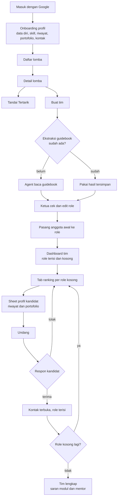
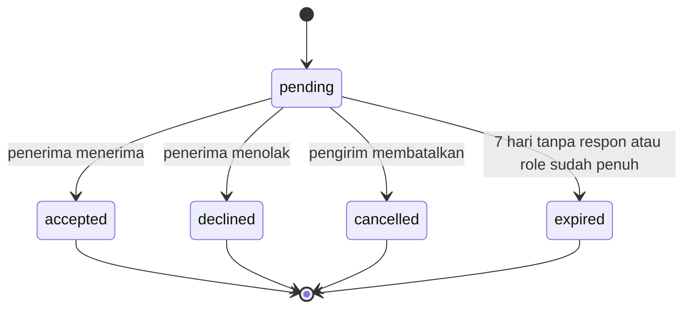
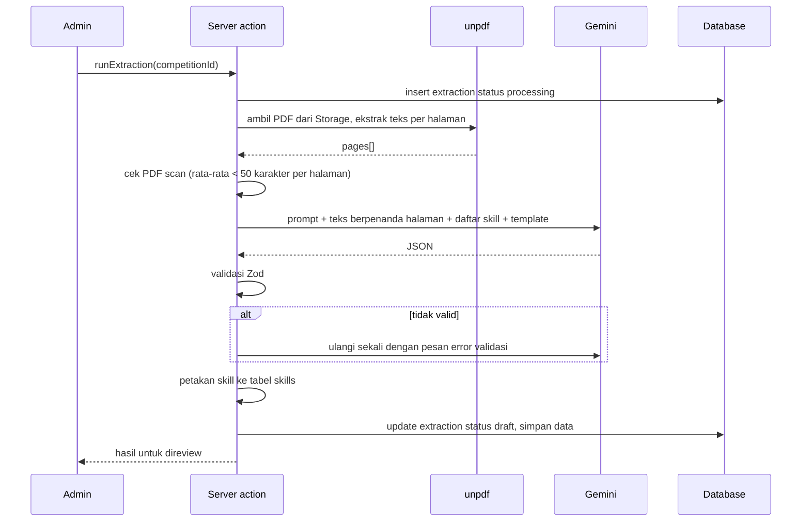
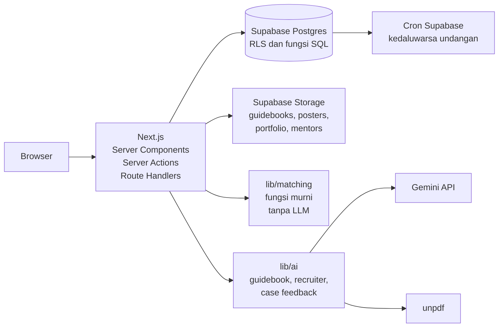

# PRD Recomp AI v1.1

**Dokumen pengembangan untuk Claude Code dan GitHub**
STACK 2026 · Case 1: Smarter Campus and Learning · Tim Cumlaude
Versi 1.2, 19 November 2026. Menggantikan PRD v1.1, v1.0, v0.2, dan PRD 5 November.

**Perubahan di v1.2**

| Bagian | Perubahan | Keputusan |
| --- | --- | --- |
| 9, 10 | Design v2: satu biru `#145AFF`, Inter dan JetBrains Mono, tombol radius 10 px, kartu bergaris, sidebar di halaman app, ranking jadi tabel di desktop | ADR 0008 |
| 19, 20.2, 20.3, 20.6, 21.7 | Pembagian tim baru: Malik dan Dhanes backend, Adnan AI dan data, Alek frontend. Kerja dibagi per fitur utuh supaya rata dan paralel | ADR 0009 |
| 21.1, 21.2 | Satu branch tetap `main`. Branch fitur dari `main`, rilis ditandai dengan tag | ADR 0009 |
| 22 | Aturan agent AI pindah ke `AGENTS.md`, `CLAUDE.md` hanya mengimpornya | - |
| 0 | Dokumen repo selain PRD ditulis dalam bahasa Inggris | - |
| 20.5, 20.6 | Video semifinal: Malik dan Dhanes. Proposal: Axeleon dan Adnan | - |
| 20.2, 20.3, 21.7 | Beban diratakan per ukuran (sekitar 27 poin per orang), kolom Ukuran di backlog | ADR 0009 |
| 6.1, 6.6, 11.3 | Nama komponen disesuaikan: `AppShell`, `Sidebar`, `CandidateRow`, `ScoreBadge` | ADR 0008 |

---

## 0. Cara memakai dokumen ini

Dokumen ini adalah satu sumber kebenaran untuk membangun Recomp AI. Dokumen ini tersimpan di `docs/PRD.md`. Aturan untuk agent AI ada di `AGENTS.md` di root repo (bagian 22).

**Aturan membaca**

- **ID fitur** (contoh `F-PRF-03`) dipakai di judul issue GitHub, nama branch, dan deskripsi pull request.
- **Kriteria selesai** ditulis dalam format Diberikan, Ketika, Maka. Sebuah issue baru boleh ditutup kalau semua kriterianya lolos.
- **Prioritas**: P0 wajib untuk semifinal, P1 wajib untuk Final Day, P2 tambahan.
- **Label status**: [KEPUTUSAN] sudah disepakati, [USULAN] boleh diganti tim, [SIMULASI] fitur atau data yang wajib diberi label simulasi di UI.
- Kalau ada yang bertentangan antara dokumen ini dan handbook STACK, handbook yang menang.

**Bahasa**

- Teks UI dalam bahasa Indonesia.
- Kode, nama tabel, nama variabel, dan pesan commit dalam bahasa Inggris.
- Proposal, video, dan deck STACK dalam bahasa Inggris.
- Dokumen repo selain PRD ini (README, AGENTS, CONTEXT, CONTRIBUTING, TODO, ADR, `docs/design-system.md`) dalam bahasa Inggris.

---

## 1. Ringkasan produk

Recomp AI adalah web app yang membantu mahasiswa membentuk tim lomba dengan role yang dibutuhkan lomba itu, lalu mendukung persiapan lewat modul belajar dan mentor.

**Alur singkat**

1. Mahasiswa login, lalu wajib melengkapi profil: role yang diminati, skill, riwayat lomba, portofolio, dan kontak.
2. Mahasiswa melihat daftar lomba yang sudah dilengkapi guidebook resmi, lalu menandai lomba yang diminati.
3. Ketua tim membuat tim untuk satu lomba. AI agent membaca guidebook dan mengusulkan role beserta skill yang dibutuhkan.
4. Ketua merapikan role. Sistem membandingkan role dengan skill anggota yang sudah ada.
5. Untuk tiap role yang kosong, sistem membuat ranking mahasiswa yang menandai lomba itu, lengkap dengan skor dan alasannya.
6. Ketua membuka profil kandidat untuk melihat riwayat lomba dan portofolio, lalu mengundang.
7. Kontak kedua pihak baru terbuka setelah undangan diterima.
8. Tim belajar lewat modul (tampilan ala Skilvul) atau menyewa mentor dari halaman mentor.

**Judul proyek [KEPUTUSAN]**: Recomp AI: One AI Platform for Competition Teams, from Matching to Mentoring.

**Versi pertama [KEPUTUSAN]**: hackathon dan lomba IT, untuk mahasiswa di satu kampus.

**Prinsip produk**

1. Skor kandidat dihitung algoritma yang bisa dijelaskan, bukan LLM.
2. AI tidak mengirim apa pun tanpa persetujuan pengguna.
3. Kontak pribadi tidak pernah tampil sebelum dua pihak setuju.
4. Data contoh dan pembayaran selalu diberi label simulasi.
5. Alur inti harus jalan tanpa error, karena Functionality and Reliability bernilai 30% di Final Day.

---

## 2. Aturan STACK yang mengikat development

Diambil dari Handbook STACK 2026. Semua anggota wajib tahu.

| No | Aturan | Dampak ke development |
| --- | --- | --- |
| 1 | Proyek harus baru dibuat untuk STACK dan tetap sama dari penyisihan sampai final | Satu repo, satu nama produk, alur inti tidak berubah |
| 2 | Tim tidak boleh mulai dari repo kosong di Final Day dan harus menyisakan pekerjaan berarti untuk build session | Sisakan 2 sampai 3 tugas (lihat bagian 20.4) |
| 3 | Komite mencatat commit awal dan akhir di Final Day dan bisa menanyakan kontribusi tiap anggota | Commit tiap anggota harus terlihat dan bisa dijelaskan |
| 4 | Bantuan AI yang material wajib diungkap di proposal dan README, termasuk alat dan perannya | Bagian "AI Disclosure" di README sejak hari pertama |
| 5 | Kredensial dibagikan dengan aman dan tidak masuk repo | `.env` di `.gitignore`, sediakan `.env.example` |
| 6 | Fitur simulasi atau belum selesai wajib ditandai | Badge "Simulasi" di UI, daftar di README |
| 7 | Produk web wajib punya deployment yang bisa diakses atau setup lokal yang andal | Deploy ke Vercel dan sediakan mode demo lokal |
| 8 | README memuat setup, dependensi, environment, akun demo, sumber pihak ketiga, keterbatasan, versi awal dan akhir, kontribusi anggota | Template README di bagian 19 |
| 9 | Fitur rencana tidak boleh diklaim selesai di proposal, video, atau deck | Daftar "Selesai" dan "Belum" selalu diperbarui |
| 10 | Data tidak boleh dikarang | Hasil uji coba dilaporkan apa adanya beserta jumlah peserta |

---

## 3. Pengguna

| Kode | Pengguna | Kebutuhan | Yang dilakukan di Recomp AI |
| --- | --- | --- | --- |
| U1 | Ketua tim (pengguna utama) | Menutup 1 atau 2 role yang kosong | Membuat tim, mengatur role, melihat ranking, membuka profil kandidat, mengundang |
| U2 | Pencari tim | Masuk ke tim yang cocok | Mengisi profil, menandai lomba, menerima atau menolak undangan, melamar ke tim |
| U3 | Pelajar | Belajar persiapan lomba | Membuka kursus, mengerjakan kuis dan studi kasus |
| U4 | Mentor | Mendapat tim yang membayar | Profil mentor, layanan, harga, jadwal |
| U5 | Admin | Menjaga kualitas data | Menambah lomba, mengunggah guidebook, menjalankan ekstraksi, memverifikasi mentor |

Satu akun bisa menjadi U1, U2, dan U3 sekaligus. Mentor dan admin dibedakan lewat kolom di database.

### 3.1 Skenario utama

Rani mau ikut hackathon X dan sudah berdua dengan Budi (backend). Rani membuka halaman lomba, menekan "Buat tim", lalu agent membaca guidebook dan mengusulkan empat role: Backend, Frontend, UI/UX, dan Pitching. UI/UX diusulkan karena kriteria "Desain antarmuka 20%" di halaman 7, dan Pitching karena kriteria "Presentasi 15%" di halaman 8. Rani menghapus Frontend karena dia sendiri bisa, lalu menyimpan.

Sistem menandai Backend terisi oleh Budi, sedangkan UI/UX dan Pitching kosong. Di tab UI/UX, Dinda ada di urutan pertama dengan skor 92. Alasannya: Figma level Mahir dengan bukti portofolio, pernah dua kali ikut hackathon dan sekali menjadi finalis, punya 6 jam per minggu atau 2 jam di bawah kebutuhan role. Rani mengklik kartu Dinda, melihat riwayat lomba dan dua karya di Behance, lalu mengundang. Dinda menerima, dan WhatsApp keduanya terbuka di halaman tim.

---

## 4. Ruang lingkup dan prioritas

### 4.1 Daftar epic

| Epic | Kode | Isi | Prioritas |
| --- | --- | --- | --- |
| Fondasi | FND | Repo, auth, layout, sistem desain, seed | P0 |
| Profil | PRF | Onboarding, skill, riwayat lomba, portofolio, kontak, profil publik | P0 |
| Lomba | CMP | Daftar, detail, minat, admin lomba | P0 |
| Guidebook AI | GBA | Ekstraksi guidebook dan usulan role | P0 |
| Tim dan role | TEM | Buat tim, editor role, anggota, gap | P0 |
| Ranking | RNK | Skor, alasan, rincian, umpan balik | P0 |
| Undangan | INV | Undang, melamar, terima, tolak, buka kontak | P0 |
| Agent perekrut | RCR | Draf undangan dengan persetujuan | P1 |
| Belajar | LRN | Katalog, kursus, pemutar materi ala Skilvul, kuis, studi kasus, akses | P1 |
| Mentor | MNT | Grid mentor, detail, booking dan pembayaran simulasi | P1 |
| Notifikasi | NTF | Badge undangan, daftar notifikasi | P1 |
| Admin | ADM | Halaman admin sederhana | P1 |
| Kualitas | QA | Tes, CI, README, deploy | P0 |

### 4.2 Di luar ruang lingkup

- Rencana persiapan otomatis per role (sudah dihapus dari abstrak).
- Pendaftaran lomba lewat aplikasi.
- Chat di dalam aplikasi.
- Pembayaran sungguhan.
- Mode gelap. Versi ini hanya tema terang.
- Aplikasi mobile native.
- AI yang membuat karya lomba untuk tim.

---

## 5. Alur dan status

### 5.1 Alur inti



### 5.2 Status tim

| Status | Arti | Transisi |
| --- | --- | --- |
| `forming` | Masih ada role kosong | Ke `complete` saat semua slot role terisi |
| `complete` | Semua slot terisi | Kembali ke `forming` kalau ketua menambah role atau anggota keluar |
| `archived` | Lomba sudah lewat atau tim dibubarkan | Akhir |

### 5.3 Status undangan



Aturan tambahan:

- Saat undangan diterima, sistem menambah `team_members`, menghitung ulang slot, dan mengubah undangan lain yang menunggu untuk role penuh menjadi `expired`.
- Kalau penerima sudah tergabung di tim lain untuk lomba yang sama, tombol terima dinonaktifkan dengan pesan "Kamu sudah punya tim untuk lomba ini".
- Satu pasangan tim dan penerima hanya boleh punya satu undangan `pending`.

### 5.4 Status ekstraksi guidebook

| Status | Arti |
| --- | --- |
| `processing` | Agent sedang berjalan |
| `draft` | Hasil sudah ada, belum diperiksa admin |
| `reviewed` | Sudah diperiksa admin, dipakai sebagai default untuk semua tim |
| `failed` | Gagal, form manual ditampilkan |

---

## 6. Spesifikasi fitur

Setiap fitur punya ID, deskripsi, kriteria selesai, dan prioritas.

### 6.1 Fondasi (FND)

**F-FND-01 Setup proyek (P0)**
Next.js App Router, TypeScript strict, Tailwind, shadcn/ui, ESLint, Prettier, Vitest, Playwright, Supabase CLI.
- Diberikan repo baru, Ketika `pnpm install && pnpm dev` dijalankan, Maka halaman landing tampil di `localhost:3000` tanpa error.
- `pnpm lint`, `pnpm typecheck`, dan `pnpm test` lolos di CI.

**F-FND-02 Auth Google (P0)**
Masuk dengan Google lewat Supabase Auth. Email dan password opsional.
- Diberikan pengguna baru, Ketika masuk pertama kali, Maka baris `profiles` dibuat otomatis lewat trigger dan pengguna diarahkan ke `/onboarding`.
- Diberikan pengguna yang `onboarding_done = true`, Ketika masuk, Maka diarahkan ke `/lomba`.
- Halaman selain landing, daftar lomba, detail lomba, dan profil publik mewajibkan login. Middleware mengarahkan pengguna tanpa sesi ke `/masuk?next=...`.

**F-FND-03 Layout dan sistem desain (P0)**
`PublicNavbar`, footer, `AppShell` dengan sidebar, token warna, font, komponen dasar. Detail di bagian 9 dan 10.0.
- Halaman publik memakai `PublicNavbar`, halaman app memakai `AppShell` (bagian 10.0).
- Tidak ada warna atau radius hardcode di luar token Tailwind.

**F-FND-04 Seed data (P0)**
Detail di bagian 15.
- Diberikan database kosong, Ketika `pnpm db:reset` dijalankan, Maka tersedia 8 lomba, 50 profil simulasi, 10 mentor simulasi, template role, dan satu kursus.

### 6.2 Profil (PRF)

**F-PRF-01 Wizard onboarding (P0)**
Setelah login pertama, pengguna wajib melengkapi profil lewat wizard ini. Selama `onboarding_done = false`, pengguna tidak bisa membuat tim, menandai lomba, atau muncul di ranking.

Empat langkah dengan indikator progres di atas: (1) Data diri, (2) Role dan skill, (3) Riwayat dan portofolio, (4) Kontak dan preferensi.

| Langkah | Field | Validasi |
| --- | --- | --- |
| 1 | Foto (default dari Google), nama lengkap, username, kampus, jurusan, angkatan, bio (maks. 280 karakter) | Username 3 sampai 20 karakter `a-z0-9_`, unik. Kampus dan jurusan wajib |
| 2 | **Role yang diminati** (pilih 1 sampai 3 dari: Backend, Frontend, UI/UX, Data/AI, Product dan Pitching, Business Case), lalu skill dari daftar tetap dengan level 1 sampai 4 dan tautan bukti opsional per skill. Setelah memilih role, sistem menyarankan skill yang umum untuk role itu (dari `role_templates`) supaya pengguna tinggal memilih | Minimal 1 role, maksimal 3. Minimal 3 skill |
| 3 | Riwayat lomba (boleh kosong), portofolio (boleh kosong) | Tautan harus URL valid `https://` |
| 4 | WhatsApp, email kontak, jam tersedia per minggu (0 sampai 40), tujuan (Juara atau Belajar), jam kerja (Pagi, Siang, Malam, Fleksibel), toggle "Terbuka untuk diajak" | WhatsApp format `+62` atau `08`, dinormalisasi ke `+62` |

- Diberikan pengguna di langkah 2, Ketika belum memilih role yang diminati, Maka tombol "Lanjut" nonaktif dan muncul pesan "Pilih minimal 1 role yang kamu minati".
- Diberikan pengguna di langkah 2, Ketika memilih kurang dari 3 skill, Maka tombol "Lanjut" nonaktif dan muncul pesan "Pilih minimal 3 skill".
- Diberikan pengguna memilih role UI/UX, Maka skill Figma, User Research, Prototyping, dan Design System muncul paling atas sebagai saran.
- Diberikan pengguna menyelesaikan langkah 4, Ketika menekan "Selesai", Maka `onboarding_done = true` dan diarahkan ke `/lomba`.
- Data tersimpan per langkah, jadi menutup tab tidak menghapus isian.

**Label level skill**

| Level | Label | Penjelasan di tooltip |
| --- | --- | --- |
| 1 | Dasar | Pernah belajar atau mencoba |
| 2 | Menengah | Pernah memakai di proyek atau tugas |
| 3 | Mahir | Pernah memakai di beberapa proyek dan bisa mandiri |
| 4 | Ahli | Bisa mengajari orang lain atau pernah juara dengan skill ini |

**F-PRF-02 Skill (P0)**
- Pengguna memilih skill dari daftar tetap per kategori (Engineering, Design, Data/AI, Product dan Bisnis, Komunikasi).
- Pengguna tidak bisa membuat skill baru. Tombol "Usulkan skill" mengirim usulan ke admin (P2).
- Skill dengan tautan bukti menampilkan ikon tautan di semua tampilan.

**F-PRF-03 Riwayat lomba (P0)**
Field: nama lomba, tahun, kategori, role di tim, hasil, tautan bukti opsional, catatan singkat opsional.
- Hasil memakai enum: Peserta, Finalis, Juara 1, Juara 2, Juara 3, Harapan.
- Riwayat ditampilkan urut tahun terbaru.

**F-PRF-04 Portofolio (P0)**
Field: judul, deskripsi (maks. 300 karakter), tautan utama, gambar sampul opsional (unggah ke Storage, maks. 2 MB, JPG atau PNG atau WebP), skill terkait.
- Diberikan gambar lebih dari 2 MB, Ketika diunggah, Maka ditolak dengan pesan yang jelas.
- Kalau tanpa gambar, kartu memakai sampul warna dengan ikon sesuai domain tautan (GitHub, Figma, Behance, lainnya).

**F-PRF-05 Kontak privat (P0)**
- WhatsApp dan email kontak disimpan di tabel `profile_contacts`, terpisah dari `profiles`.
- Hanya pemilik dan rekan setim yang sudah sama-sama bergabung yang bisa membaca. Diatur dengan RLS (bagian 12.3).
- Diberikan pengguna lain yang bukan rekan setim, Ketika memanggil API profil, Maka response tidak memuat kontak.

**F-PRF-06 Profil publik `/u/[username]` (P0)**
Lihat wireframe di bagian 10.6.
- Header: avatar, nama, kampus, jurusan, angkatan, bio, chip role yang diminati (berwarna sesuai role), badge "Terbuka untuk diajak" atau "Sedang tidak mencari tim", jam per minggu, tujuan, jam kerja.
- Bagian Skill, Riwayat lomba, Portofolio, Lomba yang diminati.
- Label kecil "Data diisi oleh pengguna" di bawah header.
- Kalau dibuka dari halaman tim lewat parameter `?team=...&role=...`, tampil panel "Kecocokan untuk role X" berisi skor dan rincian, plus tombol "Undang".
- Profil simulasi menampilkan badge "Simulasi".

**F-PRF-07 Edit profil `/profil` (P0)**
Tab yang sama dengan langkah onboarding, bisa disimpan kapan saja.

**F-PRF-08 Hapus akun (P1)**
Tombol di pengaturan. Menghapus profil, kontak, skill, riwayat, portofolio, minat, dan keanggotaan tim. Kalau pengguna adalah ketua tim, tim diarsipkan.

### 6.3 Lomba (CMP)

**F-CMP-01 Daftar lomba `/lomba` (P0)**
- Grid kartu lomba, 3 kolom di desktop, 2 di tablet, 1 di ponsel.
- Filter: kategori (chip), status deadline (Dibuka, Segera tutup dalam 7 hari, Sudah tutup), ukuran tim, kata kunci.
- Urutan default: deadline terdekat yang masih dibuka.
- Kartu: poster, chip kategori, nama, penyelenggara, deadline dengan sisa hari, ukuran tim, label "Guidebook tersedia", jumlah peminat ("24 mahasiswa tertarik"), tombol hati "Tertarik".
- Kosong: ilustrasi dan teks "Belum ada lomba yang cocok dengan filter ini".

**F-CMP-02 Detail lomba `/lomba/[slug]` (P0)**
- Hero: poster, nama, penyelenggara, kategori, deadline, tanggal acara, ukuran tim, tautan resmi, tombol unduh guidebook.
- Tombol utama: "Buat tim" (kalau belum punya tim di lomba ini) atau "Buka tim saya".
- Tombol sekunder: "Tertarik" atau "Batal tertarik".
- Tab "Ringkasan guidebook": ringkasan, kriteria penilaian (nama, bobot, halaman), deadline penting, role usulan dengan label sumber. Ditampilkan hanya kalau status ekstraksi `draft` atau `reviewed`. Kalau `draft`, tampil catatan "Ringkasan dibuat AI dan belum diperiksa admin".
- Tab "Tim yang sedang mencari": daftar tim `forming` untuk lomba ini dengan role kosongnya, plus tombol "Lamar". **Disisakan untuk Final Day** bersama F-INV-05.

**F-CMP-03 Tertarik (P0)**
- Diberikan pengguna login, Ketika menekan "Tertarik", Maka baris `competition_interests` dibuat dan jumlah peminat bertambah tanpa reload.
- Hanya pengguna yang menandai "Tertarik" yang bisa muncul di ranking untuk lomba itu.
- Pengguna yang belum login diarahkan ke `/masuk`.

**F-CMP-04 Admin lomba (P0, UI sederhana)**
- Form tambah dan edit lomba, unggah PDF guidebook ke bucket `guidebooks` (maks. 20 MB, hanya `application/pdf`).
- Tombol "Jalankan ekstraksi", lalu halaman review hasil ekstraksi yang bisa diedit dan disetujui (`reviewed`).

**F-CMP-05 Lomba unggulan (P2)**
Kolom `is_featured` dan label "Media Partner". Lomba unggulan tampil di urutan atas.

### 6.4 Guidebook AI (GBA)

Spesifikasi teknis lengkap di bagian 8.1.

**F-GBA-01 Ekstraksi guidebook (P0)**
- Diberikan PDF berbasis teks, Ketika ekstraksi dijalankan, Maka dalam 60 detik tersimpan JSON valid yang memuat ringkasan, ukuran tim, deadline, kriteria penilaian, dan role usulan, masing-masing dengan nomor halaman.
- Diberikan PDF hasil scan (teks per halaman kurang dari 50 karakter rata-rata), Maka status `failed` dengan pesan "Guidebook berupa gambar. Isi role secara manual atau unggah PDF berbasis teks".
- Diberikan output LLM yang tidak lolos validasi schema, Maka sistem mencoba ulang sekali dengan pesan perbaikan. Kalau masih gagal, status `failed`.

**F-GBA-02 Pemetaan skill (P0)**
- Setiap skill dari LLM dicocokkan ke tabel `skills` lewat slug dan alias. Skill yang tidak cocok ditandai `unmatched` dan ditampilkan di editor role dengan pilihan padanan.

**F-GBA-03 Cache per lomba (P0)**
- Hasil ekstraksi disimpan per lomba. Tim baru memakai hasil terakhir berstatus `reviewed`, atau `draft` kalau belum ada yang `reviewed`. Guidebook yang sama tidak diproses ulang.

**F-GBA-04 Form cadangan (P0)**
- Kalau tidak ada hasil ekstraksi yang bisa dipakai, editor role terbuka dengan template kategori dan pesan "AI belum bisa membaca guidebook ini. Kamu bisa mulai dari template".

### 6.5 Tim dan role (TEM)

**F-TEM-01 Buat tim (P0)**
Wizard 3 langkah di `/tim/baru?lomba=[slug]`:
1. Nama tim, tujuan tim (Juara atau Belajar), jam kerja tim.
2. Review role usulan (editor role, F-TEM-02).
3. Pasang anggota awal: ketua otomatis masuk dan memilih role-nya sendiri. Ketua bisa menambah anggota yang sudah ada lewat username (anggota itu menerima undangan biasa).

- Diberikan pengguna yang sudah punya tim di lomba itu, Ketika membuka `/tim/baru`, Maka diarahkan ke tim yang sudah ada.
- Diberikan jumlah total slot role lebih besar dari ukuran tim maksimal lomba, Maka muncul peringatan "Total slot melebihi batas tim lomba (maks. 4)" dan tombol simpan nonaktif.

**F-TEM-02 Editor role (P0)**
Satu kartu per role berisi:

| Field | Input | Validasi |
| --- | --- | --- |
| Nama role | Teks | 2 sampai 40 karakter |
| Deskripsi | Teks area | Maks. 200 karakter |
| Skill wajib | Pilih skill dan level minimal | Minimal 1 |
| Skill tambahan | Pilih skill | Opsional |
| Jam per minggu | Angka | 1 sampai 40 |
| Jumlah slot | Angka | 1 sampai 3 |
| Sumber | Otomatis | `guidebook`, `criteria`, `template`, atau `manual` |
| Halaman sumber | Otomatis | Angka atau kosong |

- Tombol "Tambah role" membuka pilihan: "Dari template" atau "Kosong". Role baru bersumber `manual`.
- Setiap kartu menampilkan label sumber: "Dari guidebook hal. 7", "Dari kriteria Desain antarmuka 20% (hal. 7)", "Template hackathon", atau "Ditambah ketua".
- Mengubah role yang sudah punya anggota memunculkan konfirmasi.

**F-TEM-03 Dashboard tim `/tim/[id]` (P0)**
Lihat wireframe di bagian 10.4.
- Header: nama tim, lomba (tautan), status, progres slot ("3 dari 4 terisi"), tombol "Edit role".
- Kolom kiri: daftar kartu role. Role terisi menampilkan avatar dan nama anggota. Role kosong menampilkan tombol "Lihat kandidat".
- Kolom kanan: anggota dengan kontak (hanya untuk anggota tim), undangan keluar dengan statusnya.
- Ringkasan gap: "Skill wajib yang belum tertutup: Figma, Public Speaking".
- Saat tim `complete`: kartu "Tim lengkap" dengan saran kursus dan mentor yang cocok dengan kategori lomba.

**F-TEM-04 Hitung gap (P0)**
- Role dianggap terisi kalau jumlah anggota yang dipasang ke role itu sama dengan `slots`.
- Gap skill = skill wajib dari role kosong.

**F-TEM-05 Keluar dan keluarkan anggota (P1)**
- Anggota bisa keluar. Ketua bisa mengeluarkan anggota dengan konfirmasi. Slot role kembali kosong dan status tim kembali `forming`.

### 6.6 Ranking (RNK)

Rumus lengkap di bagian 7.

**F-RNK-01 Ranking per role (P0)**
- Halaman tim menampilkan tab untuk setiap role kosong. Tab aktif menampilkan maksimal 20 kandidat teratas, dengan tombol "Muat lagi".
- Baris kandidat (`CandidateRow` di desktop, `CandidateCard` di ponsel): avatar, nama, kampus dan jurusan, angkatan, `ScoreBadge` 0 sampai 100, tiga alasan teratas dengan ikon, chip skill cocok (hijau) dan skill wajib yang belum dimiliki (abu-abu bergaris), badge "Simulasi" kalau profil simulasi, tombol "Profil" dan "Undang".
- Diberikan tidak ada kandidat, Maka tampil "Belum ada mahasiswa yang tertarik dengan lomba ini dan cocok dengan role ini. Bagikan lomba ini ke temanmu" dengan tombol salin tautan.

**F-RNK-02 Rincian skor (P0)**
- Klik `ScoreBadge` membuka popover berisi lima faktor dengan bar dan nilainya, contoh "Penutupan role 40/40".

**F-RNK-03 Sheet profil cepat (P0)**
- Klik baris kandidat atau "Profil" membuka sheet dari kanan (lebar 560 px di desktop, layar penuh di ponsel).
- Isi sheet: header profil, panel kecocokan, skill, riwayat lomba (maks. 5 terbaru, dengan "Lihat semua"), portofolio (maks. 4, grid 2 kolom), tombol "Buka profil lengkap" dan "Undang".

**F-RNK-04 Filter wajib (P0)**
Kandidat yang tidak lolos filter di bagian 7.1 tidak boleh muncul. Ditutup dengan unit test.

**F-RNK-05 Umpan balik (P1)**
- Dua tombol kecil di kartu: "Cocok" dan "Kurang cocok". Disimpan di `recommendation_feedback` untuk metrik uji coba.

### 6.7 Undangan (INV)

**F-INV-01 Undang (P0)**
- Tombol "Undang" membuka dialog: role (terkunci ke role tab), pesan (template awal bisa diedit, maks. 500 karakter), tombol "Kirim undangan".
- Template pesan awal: "Halo [nama], aku [ketua] dari tim [tim] untuk [lomba]. Kami lagi cari [role] dan profilmu cocok karena [alasan teratas]. Mau gabung?"
- Diberikan undangan terkirim, Maka kartu kandidat berubah menjadi "Menunggu respon" dan tombol undang nonaktif.

**F-INV-02 Kotak undangan `/undangan` (P0)**
- Tab "Masuk" dan "Terkirim".
- Kartu undangan masuk: lomba, tim, role yang ditawarkan (skill wajib dan jam), anggota saat ini (avatar dan nama), pesan, waktu, tombol "Terima" dan "Tolak".
- Badge jumlah undangan `pending` di navbar.

**F-INV-03 Terima dan tolak (P0)**
- Terima: dijalankan dalam satu transaksi database (fungsi `accept_invite`) supaya tidak ada dua orang mengisi slot terakhir bersamaan.
- Tolak: status `declined`, kandidat tidak muncul lagi di ranking tim itu.

**F-INV-04 Buka kontak (P0)**
- Diberikan undangan diterima, Maka di dashboard tim setiap anggota melihat WhatsApp (tombol "Chat di WhatsApp" dengan tautan `https://wa.me/62...`) dan email anggota lain.

**F-INV-05 Melamar ke tim (disisakan untuk Final Day)**
- Dari tab "Tim yang sedang mencari" di detail lomba, pengguna bisa melamar untuk role kosong. Undangan dibuat dengan `direction = 'apply'`, dan ketua menerima atau menolak.

**F-INV-06 Batalkan dan kedaluwarsa (P1)**
- Pengirim bisa membatalkan undangan `pending`.
- Undangan `pending` lebih dari 7 hari menjadi `expired` (dicek saat halaman dibuka atau lewat cron Supabase).

### 6.8 Agent perekrut (RCR)

Spesifikasi teknis di bagian 8.2.

**F-RCR-01 Draf undangan (P1)**
- Tombol "Bantu rekrut" di tab role. Agent mengambil 3 kandidat teratas yang belum diundang, lalu menulis draf pesan personal.
- Draf ditampilkan sebagai daftar kartu yang bisa diedit. Setiap kartu punya tombol "Kirim" dan "Lewati".
- Tidak ada undangan terkirim tanpa klik "Kirim".

**F-RCR-02 Kandidat berikutnya (P1)**
- Diberikan undangan hasil agent ditolak, Maka di tab role muncul saran "Dinda menolak. Mau aku siapkan draf untuk kandidat berikutnya?".

**F-RCR-03 Log agent (P1)**
- Semua langkah agent disimpan di `agent_actions` dengan status persetujuan.

### 6.9 Belajar (LRN)

Tampilan pemutar materi meniru pola Skilvul (panel materi dan panel soal berdampingan), tetapi memakai warna, ikon, dan aset Recomp AI sendiri. Jangan memakai logo, ilustrasi, atau teks Skilvul. Wireframe di bagian 10.7.

**Struktur konten**: Kursus → Bab → Materi → Soal.

**F-LRN-01 Katalog `/belajar` (P1)**
- Grid kartu kursus: sampul, kategori lomba, judul, jumlah materi, estimasi durasi, level, harga atau label "Gratis untuk pengguna awal" [SIMULASI], progres kalau sudah dimulai.

**F-LRN-02 Halaman kursus `/belajar/[kursus]` (P1)**
- Hero kursus, deskripsi, apa yang dipelajari, daftar bab yang bisa dibuka-tutup, materi dengan ikon status (selesai, sedang, terkunci).
- Tombol "Mulai belajar" atau "Lanjutkan".

**F-LRN-03 Pemutar materi `/belajar/[kursus]/[materi]` (P1)**

| Area | Isi |
| --- | --- |
| Bar atas (64 px, putih, garis bawah) | Logo kecil, breadcrumb dropdown "Kursus > Bab > Materi" (klik membuka daftar materi), progress bar dengan teks "3/27 latihan selesai", chip poin "120 poin", tombol "Panduan", tombol menu |
| Panel kiri (50%) | Kartu "Catatan" (ikon catatan, poin aturan seperti "Periksa jawaban sebelum dikirim" dan "Jawaban hanya bisa dikirim sekali", tombol lebar "Tanya Mentor"), lalu kartu "Materi" (judul besar, paragraf, list, gambar, blok kode dengan highlight, video embed, callout) |
| Panel kanan (50%) | Kartu "Pertanyaan" (ikon tanda tanya), banner tipis warna `wash` "Kamu mendapatkan: 5 poin", lalu daftar soal |
| Soal pilihan ganda | Label poin "(5 poin)", teks soal, opsi berbentuk kartu dengan kotak huruf A, B, C di kiri. Setelah dikirim: opsi benar diberi garis hijau dan ikon centang, opsi salah yang dipilih diberi garis merah, penjelasan muncul di bawah |
| Soal studi kasus | Teks soal, rubrik singkat, textarea (maks. 2.000 karakter), tombol "Kirim untuk dinilai", hasil feedback AI per kriteria rubrik |
| Bar bawah (56 px, warna primary penuh) | Kiri "‹ [judul materi sebelumnya]", kanan "[judul materi berikutnya] ›", judul dipotong elipsis |
| Scroll | Kedua panel scroll sendiri, bar atas dan bawah tetap |
| Ponsel (< 1024 px) | Panel bertumpuk, tab "Materi" dan "Soal" di bawah bar atas |

- Diberikan pengguna mengirim jawaban pilihan ganda, Maka jawaban terkunci (satu kali kirim), poin bertambah kalau benar, dan progres bertambah.
- Materi dianggap selesai kalau semua soalnya sudah dijawab, atau kalau materi tanpa soal sudah di-scroll sampai bawah.

**F-LRN-04 Feedback studi kasus (P1)**
Spesifikasi di bagian 8.3. Label "Feedback dibuat AI dan bisa keliru".

**F-LRN-05 Akses kursus [SIMULASI] (P1)**
- Bab pertama gratis (`is_free_preview`).
- Materi berikutnya terkunci dengan kartu "Buka kursus ini" berisi harga, input kode promo, dan tombol "Bayar (Simulasi)".
- Kode promo `PENGGUNAAWAL` memberi akses gratis, kuota 100 [USULAN].

**F-LRN-06 Konten (P1)**
Satu kursus "Persiapan Hackathon" ditulis tim sendiri:

| Bab | Materi |
| --- | --- |
| 1. Memahami lomba | Membaca guidebook dan kriteria, menentukan role tim, menyusun timeline kerja |
| 2. Dari masalah ke solusi | Menulis problem statement, validasi pengguna, menentukan scope MVP |
| 3. Demo dan pitching | Struktur pitch deck, demo yang aman, menjawab pertanyaan juri |

Setiap materi berisi 2 sampai 4 soal pilihan ganda. Bab 2 dan 3 masing-masing punya satu studi kasus.

### 6.10 Mentor (MNT)

**F-MNT-01 Grid mentor `/mentor` (P1)**
Lihat wireframe di bagian 10.8.
- Judul halaman dan subjudul, filter role sebagai chip (Semua, Backend, Frontend, UI/UX, Data/AI, Product, Pitching, Business Case), filter kategori lomba, rentang harga, urutan (Rekomendasi, Harga terendah).
- Grid kartu wajah: foto besar persegi membulat (rasio 1:1, radius 16 px), chip role berwarna, nama, satu baris kredensial ("Juara 1 GEMASTIK 2024, kategori UX"), kategori lomba yang dikuasai, "Mulai dari Rp75.000" [SIMULASI], badge "Terverifikasi" atau "Simulasi".
- 4 kolom di layar lebar, 3 di desktop, 2 di tablet, 1 di ponsel.
- Mentor tanpa foto memakai avatar inisial besar dengan warna dari role utamanya.

**F-MNT-02 Detail mentor `/mentor/[id]` (P1)**
- Kiri: foto besar, nama, chip role, kredensial, bio, prestasi (timeline), lomba yang dikuasai.
- Kanan (sticky): daftar layanan (contoh "Review proposal 60 menit", "Review pitch deck", "Konsultasi tim 60 menit") dengan harga, pilihan jadwal, tombol "Hubungkan dengan mentor".

**F-MNT-03 Booking dan pembayaran simulasi (P1)**
1. Pilih tim (harus ketua atau anggota tim), layanan, dan jadwal.
2. Halaman checkout simulasi: rincian layanan, total, potongan platform 20% [USULAN], bagian mentor, banner kuning "Ini pembayaran simulasi. Tidak ada uang yang ditarik".
3. Tombol "Bayar (Simulasi)" mengubah status booking menjadi `paid` dan slot jadwal menjadi terpakai.
4. Kontak mentor dan jadwal muncul di dashboard tim pada kartu "Sesi mentor".

**F-MNT-04 Riwayat transaksi (P1)**
Daftar booking tim dengan total, potongan platform, bagian mentor, status.

**F-MNT-05 Verifikasi mentor (P2)**
Admin mengubah `verified`. Mentor asli hanya tampil setelah diverifikasi.

**F-MNT-06 Rating dan ulasan mentor (disisakan untuk Final Day)**
Setelah booking berstatus `done`, anggota tim bisa memberi rating 1 sampai 5 dan ulasan singkat. Rata-rata rating tampil di kartu dan detail mentor.

**Aturan data mentor**: mentor asli hanya boleh dipakai dengan izin tertulis, termasuk fotonya. Tanpa izin, pakai profil fiktif berlabel [SIMULASI] dan avatar inisial.

### 6.11 Notifikasi (NTF)

**F-NTF-01 (P1)** Tabel `notifications`, ikon lonceng di navbar dengan jumlah belum dibaca, dropdown 10 terbaru. Jenis: undangan masuk, undangan diterima, undangan ditolak, booking berhasil.

### 6.12 Admin (ADM)

**F-ADM-01 (P1)** Halaman `/admin` untuk pengguna dengan `app_role = 'admin'`: kelola lomba, unggah guidebook, jalankan dan review ekstraksi, kelola mentor, lihat metrik uji coba (bagian 17).

---

## 7. Role dan algoritma ranking

### 7.1 Role ditentukan oleh apa

Role selalu punya sumber, supaya ketua dan juri tahu dari mana role itu datang.

| Urutan | Sumber | Kapan dipakai | Label di UI |
| --- | --- | --- | --- |
| 1 | `guidebook` | Guidebook menyebut role atau komposisi tim secara langsung | "Dari guidebook hal. 3" |
| 2 | `criteria` | Role diturunkan dari kriteria penilaian. Contoh "Desain antarmuka 20%" jadi UI/UX, "Presentasi 15%" jadi Pitching, "Model machine learning" jadi Data/AI | "Dari kriteria Desain antarmuka 20% (hal. 7)" |
| 3 | `template` | Guidebook tidak memberi petunjuk, atau ekstraksi gagal | "Template hackathon" |
| 4 | `manual` | Ketua menambah atau mengubah role | "Ditambah ketua" atau "Diubah ketua" |

Ketua selalu punya keputusan akhir. Kalau ketua mengubah role dari agent, `source` tetap tercatat dan ditambah tanda `edited = true`.

**Template role hackathon [USULAN]**

| Role | Skill wajib (level minimal) | Skill tambahan | Jam per minggu |
| --- | --- | --- | --- |
| Backend Developer | Backend Development (2), Database (2) | API Design, Cloud Deployment | 10 |
| Frontend Developer | Frontend Development (2), React (2) | Next.js, Tailwind CSS | 10 |
| UI/UX Designer | Figma (2), User Research (1) | Prototyping, Design System | 8 |
| Data/AI Engineer | Python (2), Machine Learning (2) | LLM Integration, Data Analysis | 10 |
| Product dan Pitching | Public Speaking (2), Product Management (1) | Business Model, Pitch Deck | 6 |

Template untuk kategori lain (lomba UI/UX, data, business case) diisi di seed dengan pola yang sama.

### 7.2 Filter wajib

Kandidat masuk ranking role R di tim T untuk lomba L hanya kalau semua syarat ini terpenuhi:

1. Menandai lomba L sebagai "Tertarik".
2. `open_to_invite = true` dan `onboarding_done = true`.
3. Belum menjadi anggota tim mana pun untuk lomba L.
4. Bukan anggota tim T.
5. Belum menolak undangan dari tim T, dan tidak punya undangan `pending` dari tim T.
6. Memenuhi syarat lomba di `competitions.eligibility` (contoh jenjang S1), kalau diisi.
7. Memiliki minimal satu skill wajib dari role R.

### 7.3 Lima faktor skor

Semua faktor bernilai 0 sampai 1. Bobot disimpan di tabel `matching_config` [USULAN, perlu diuji].

| Faktor | Kunci | Bobot | Rumus |
| --- | --- | --- | --- |
| Penutupan role | `coverage` | 0,40 | `required_owned / required_total`, ditambah `0,1 × optional_owned / optional_total` kalau ada skill tambahan, maksimal 1 |
| Level skill | `level` | 0,20 | Rata-rata `min(level_kandidat / level_minimum, 1) × evidence_factor` untuk setiap skill wajib yang dimiliki. `evidence_factor` = 1 kalau ada tautan bukti, 0,85 kalau tidak |
| Ketersediaan | `availability` | 0,20 | `min(hours_kandidat / hours_role, 1)` |
| Pengalaman | `experience` | 0,10 | `min(jumlah riwayat lomba di kategori yang sama / 3, 1)`, ditambah 0,2 kalau pernah Finalis atau Juara, maksimal 1 |
| Minat, tujuan, dan gaya kerja | `fit` | 0,10 | 0,4 kalau role ini ada di role yang diminati kandidat (`preferred_roles` memuat `color_key` role), 0,3 kalau `goal` sama dengan tim, 0,3 kalau `work_time` sama dengan tim atau salah satunya `flexible` |

```
score = round(100 × (0,40 × coverage + 0,20 × level + 0,20 × availability + 0,10 × experience + 0,10 × fit))
```

**Urutan**: skor tertinggi. Kalau sama, jumlah skill wajib yang punya bukti, lalu `profiles.updated_at` terbaru.

**Atribut yang dilarang**: gender, agama, suku, asal kampus, foto, usia, angkatan. Kolom ini tidak boleh dibaca oleh fungsi skor.

### 7.4 Alasan

Alasan dibuat dari template di kode, bukan LLM, lalu diurutkan dari faktor terkuat. Maksimal 3 alasan di kartu, semua alasan di sheet profil.

| Kondisi | Template alasan | Ikon |
| --- | --- | --- |
| `coverage = 1` | "Menutup semua skill wajib: Figma, User Research" | centang hijau |
| `0 < coverage < 1` | "Menutup 1 dari 2 skill wajib: Figma" | centang kuning |
| Skill wajib dengan level ≥ 3 dan bukti | "Figma level Mahir, ada bukti portofolio" | tautan |
| `experience ≥ 0,6` | "Pernah ikut 2 hackathon, sekali finalis" | piala |
| `availability < 1` | "6 jam per minggu, 2 jam di bawah kebutuhan role" | jam kuning |
| `availability = 1` | "Bisa 10 jam per minggu, sesuai kebutuhan role" | jam hijau |
| Role ada di `preferred_roles` | "Memang berminat jadi UI/UX Designer" | bintang |
| Goal dan jam kerja sama | "Tujuan dan jam kerja sama dengan tim" | orang |

### 7.5 Implementasi

```ts
// lib/matching/types.ts
export type Level = 1 | 2 | 3 | 4;

export type RoleKey = "backend" | "frontend" | "uiux" | "data" | "product" | "business" | "other";

export interface RoleRequirement {
  id: string;
  name: string;
  colorKey: RoleKey;
  requiredSkills: { skillId: number; minLevel: Level }[];
  optionalSkillIds: number[];
  hoursPerWeek: number;
}

export interface CandidateInput {
  profileId: string;
  preferredRoles: RoleKey[]; // 1 sampai 3
  skills: { skillId: number; level: Level; hasEvidence: boolean }[];
  hoursPerWeek: number;
  goal: "win" | "learn";
  workTime: "morning" | "afternoon" | "night" | "flexible";
  history: { category: string; result: string }[];
  updatedAt: string;
}

export interface TeamContext {
  competitionCategory: string;
  goal: "win" | "learn";
  workTime: "morning" | "afternoon" | "night" | "flexible";
}

export interface MatchingConfig {
  weights: { coverage: number; level: number; availability: number; experience: number; fit: number };
  noEvidenceFactor: number; // 0.85
  optionalBonus: number;    // 0.1
  experienceCap: number;    // 3
  podiumBonus: number;      // 0.2
}

export interface ScoreResult {
  profileId: string;
  score: number; // 0..100
  factors: Record<keyof MatchingConfig["weights"], number>; // 0..1
  matchedRequired: number[];
  missingRequired: number[];
  reasons: { code: string; text: string; icon: string }[];
}
```

```ts
// lib/matching/score.ts (pseudocode yang harus diimplementasikan sebagai fungsi murni)
export function scoreCandidate(role, cand, team, cfg, skillNames): ScoreResult | null {
  const owned = new Map(cand.skills.map(s => [s.skillId, s]));
  const req = role.requiredSkills;
  const matched = req.filter(r => owned.has(r.skillId));
  if (matched.length === 0) return null; // filter 7.2 nomor 7

  const optOwned = role.optionalSkillIds.filter(id => owned.has(id)).length;
  const optBonus = role.optionalSkillIds.length
    ? cfg.optionalBonus * (optOwned / role.optionalSkillIds.length) : 0;
  const coverage = Math.min(matched.length / req.length + optBonus, 1);

  const level = avg(matched.map(r => {
    const s = owned.get(r.skillId)!;
    return Math.min(s.level / r.minLevel, 1) * (s.hasEvidence ? 1 : cfg.noEvidenceFactor);
  }));

  const availability = Math.min(cand.hoursPerWeek / role.hoursPerWeek, 1);

  const sameCat = cand.history.filter(h => h.category === team.competitionCategory);
  const podium = sameCat.some(h => h.result !== "participant");
  const experience = Math.min(sameCat.length / cfg.experienceCap + (podium ? cfg.podiumBonus : 0), 1);

  const fit = (cand.preferredRoles.includes(role.colorKey) ? 0.4 : 0)
    + (cand.goal === team.goal ? 0.3 : 0)
    + (cand.workTime === team.workTime || [cand.workTime, team.workTime].includes("flexible") ? 0.3 : 0);

  const w = cfg.weights;
  const raw = w.coverage * coverage + w.level * level + w.availability * availability
    + w.experience * experience + w.fit * fit;

  return {
    profileId: cand.profileId,
    score: Math.round(raw * 100),
    factors: { coverage, level, availability, experience, fit },
    matchedRequired: matched.map(m => m.skillId),
    missingRequired: req.filter(r => !owned.has(r.skillId)).map(r => r.skillId),
    reasons: buildReasons(/* ... bagian 7.4 ... */),
  };
}

export function rankCandidates(role, candidates, team, cfg, skillNames): ScoreResult[] {
  return candidates
    .map(c => scoreCandidate(role, c, team, cfg, skillNames))
    .filter((r): r is ScoreResult => r !== null)
    .sort(byScoreThenEvidenceThenRecency);
}
```

Filter 7.2 nomor 1 sampai 6 dijalankan di query SQL (fungsi `ranking_candidates`, bagian 12.4). Filter nomor 7 dan skor dijalankan di TypeScript.

### 7.6 Contoh perhitungan (dipakai sebagai unit test)

Role UI/UX: Figma (min 2) dan User Research (min 1) wajib, Prototyping tambahan, 8 jam per minggu. Tim: tujuan Juara, jam kerja Malam, kategori hackathon.

Kandidat Dinda: role diminati UI/UX dan Product, Figma 3 dengan bukti, User Research 2 tanpa bukti, Prototyping 2, 6 jam per minggu, dua hackathon (satu Finalis), tujuan Juara, jam kerja Malam.

| Faktor | Hitungan | Nilai | × bobot |
| --- | --- | --- | --- |
| coverage | 2/2 + 0,1 × 1/1 = 1,1, dibatasi 1 | 1,000 | 0,400 |
| level | Figma min(3/2,1) × 1 = 1; User Research min(2/1,1) × 0,85 = 0,85; rata-rata | 0,925 | 0,185 |
| availability | 6/8 | 0,750 | 0,150 |
| experience | 2/3 + 0,2 | 0,867 | 0,087 |
| fit | 0,4 (minat UI/UX) + 0,3 (tujuan sama) + 0,3 (jam kerja sama) | 1,000 | 0,100 |
| **Skor** | | | **0,922 → 92** |

Test wajib di `lib/matching/score.test.ts`:

1. Contoh Dinda menghasilkan skor 92 dan faktor seperti tabel.
2. Kandidat tanpa skill wajib menghasilkan `null`.
3. Kandidat yang sama dengan bukti punya skor lebih tinggi daripada tanpa bukti.
4. Mengubah bobot di config mengubah skor sesuai rumus.
5. Dua kandidat yang hanya berbeda kampus atau angkatan punya skor sama.
6. Urutan seri mengikuti jumlah bukti, lalu `updatedAt`.
7. Kandidat yang meminati role itu mendapat `fit` 0,4 lebih tinggi daripada kandidat identik yang tidak meminatinya.

---

## 8. AI dan agent

### 8.1 Agent guidebook

**Teknologi [USULAN]**: SDK `@google/genai`, model diatur lewat env `GEMINI_MODEL` (pakai model Gemini Flash terbaru yang tersedia di akun), output JSON lewat `responseMimeType: "application/json"` dan `responseSchema`. Ekstraksi teks PDF dengan `unpdf` per halaman.

**Alur teknis**



**Batas input**

- Maksimal 60 halaman dan 120.000 karakter. Kalau lebih, potong dan beri peringatan di hasil.
- Teks tiap halaman diberi penanda `=== PAGE 7 ===` supaya LLM bisa menunjuk halaman.
- Timeout 55 detik. Set `export const maxDuration = 60` di route.

**Prompt sistem** (simpan di `lib/ai/prompts/guidebook.ts`, beri versi `GUIDEBOOK_PROMPT_VERSION = "v1"`)

```text
You read Indonesian or English student competition guidebooks and return structured JSON.

Rules:
1. Use only information in the guidebook text. Never invent criteria, weights, dates, or roles.
2. Every criterion, deadline, and role must include the page number where you found the evidence. The text marks pages as "=== PAGE n ===". If you cannot point to a page, set page to null.
3. Role names must be short and common, such as "Backend Developer", "UI/UX Designer", "Data/AI Engineer", "Product and Pitching".
4. Suggest roles in this order of evidence:
   a. "guidebook": the guidebook names roles or team composition directly.
   b. "criteria": derive a role from a judging criterion that needs a distinct skill.
   c. "template": only if a and b give nothing; copy from the provided template list.
5. The total number of role slots must not exceed the maximum team size.
6. For skills, use names from the provided skill list whenever possible. Use min_level 1 to 4 (1 basic, 2 intermediate, 3 advanced, 4 expert).
7. Write "summary" and every "reason" in Indonesian, in plain language, at most 2 sentences.
8. Return JSON only, matching the schema.
```

**Pesan pengguna**

```text
Competition category: {category}
Skill list: {skill names, comma separated}
Role templates for this category: {template JSON}

Guidebook text:
=== PAGE 1 ===
...
```

**Schema Zod** (simpan di `lib/ai/schemas.ts`)

```ts
import { z } from "zod";

const page = z.number().int().positive().nullable();

export const GuidebookExtraction = z.object({
  summary: z.string().max(600),
  team_size: z.object({ min: z.number().int().min(1), max: z.number().int().max(10), page }),
  deadlines: z.array(z.object({ name: z.string(), date: z.string().regex(/^\d{4}-\d{2}-\d{2}$/).nullable(), page })).max(15),
  judging_criteria: z.array(z.object({
    name: z.string(),
    weight_percent: z.number().min(0).max(100).nullable(),
    description: z.string().max(300).optional(),
    page,
  })).max(20),
  suggested_roles: z.array(z.object({
    name: z.string().min(2).max(40),
    reason: z.string().max(300),
    source: z.enum(["guidebook", "criteria", "template"]),
    source_criterion: z.string().nullable(),
    page,
    required_skills: z.array(z.object({ skill: z.string(), min_level: z.number().int().min(1).max(4) })).min(1).max(6),
    optional_skills: z.array(z.string()).max(6),
    hours_per_week: z.number().int().min(1).max(40),
    slots: z.number().int().min(1).max(3),
  })).min(1).max(6),
  warnings: z.array(z.string()).max(10),
});
```

**Pemetaan skill**: cocokkan nama ke `skills.name` atau `skills.aliases` tanpa membedakan huruf besar kecil. Yang tidak cocok disimpan dengan `skill_id = null` dan `unmatched_name`, lalu editor role meminta ketua memilih padanan.

**Evaluasi akurasi**: siapkan file `eval/guidebooks.json` berisi 5 sampai 10 guidebook dengan kriteria yang diisi manual. Skrip `pnpm eval:guidebook` membandingkan hasil ekstraksi dan mencetak persentase kriteria yang benar (nama cocok dan halaman cocok). Hasilnya dipakai untuk proposal.

### 8.2 Agent perekrut

**Input**: `teamRoleId`, ketua yang sedang login.

**Langkah**

1. Panggil `rankCandidates`. Ambil 3 kandidat teratas yang belum diundang oleh tim ini.
2. Untuk setiap kandidat, kirim ke LLM hanya data ini: nama depan, skill yang cocok, alasan dari 7.4, nama tim, nama lomba, nama role, nama depan ketua.
3. LLM mengembalikan `{ candidateId, message }` per kandidat. Validasi panjang pesan 80 sampai 500 karakter.
4. Simpan ke `agent_actions` dengan `approval = 'pending'`.
5. UI menampilkan draf. Undangan hanya dibuat saat ketua menekan "Kirim" (`approval = 'approved'`).

**Prompt sistem**

```text
You write short, friendly team invitation messages in casual Indonesian for university students.
Use only the facts given. Do not add achievements, skills, or numbers that are not in the input.
Each message: greet by first name, say which team and competition, which role, one concrete reason from the given reasons, and ask if they want to join. 2 to 4 sentences, no emojis, no em dashes.
Return JSON: [{ "candidateId": string, "message": string }].
```

**Cek setelah LLM**: tolak pesan yang memuat angka atau nama skill yang tidak ada di input, lalu pakai template F-INV-01 sebagai gantinya.

### 8.3 Feedback studi kasus

**Input**: soal, rubrik (`[{ criterion, description, max_score }]`), jawaban pengguna.

**Output schema**

```ts
export const CaseFeedback = z.object({
  scores: z.array(z.object({
    criterion: z.string(),
    score: z.number().min(0),
    max_score: z.number().positive(),
    quote: z.string().max(200).nullable(), // kutipan bagian jawaban yang dinilai
    comment: z.string().max(400),
    suggestion: z.string().max(400),
  })),
  overall: z.string().max(500),
});
```

**Prompt sistem**

```text
You grade a student's answer against a rubric. Be fair and specific.
For each rubric criterion, give a score, quote the part of the answer you are judging (or null if missing), explain briefly, and give one concrete improvement.
Never rewrite the full answer for the student. Write comments in Indonesian. Return JSON only.
```

Simpan hasil di `attempts.ai_feedback`. Satu jawaban studi kasus boleh dikirim ulang maksimal 3 kali.

### 8.4 Aturan umum AI

- API key hanya di server (`GEMINI_API_KEY`), tidak pernah dikirim ke browser.
- Rate limit sederhana per pengguna: maksimal 10 panggilan agent per jam (tabel `agent_actions` dipakai sebagai hitungan).
- Semua output AI ditandai di UI dengan ikon kecil dan teks "Dibuat AI".
- Kalau `GEMINI_API_KEY` kosong, aplikasi tetap jalan: ekstraksi menampilkan form manual, agent perekrut memakai template, studi kasus menampilkan "Feedback AI belum aktif".
- Semua panggilan dicatat di `agent_actions` (agent, input ringkas, output, durasi, status).

---

## 9. Sistem desain (tema terang, v2)

Bagian ini adalah spesifikasi desain. Implementasinya (blok `@theme` Tailwind, resep kelas komponen, tabel kontras, checklist review UI) ada di `docs/design-system.md`. Alasan perubahan dari v1.1 ada di ADR 0008.

### 9.1 Arah gaya

Referensi v1.1 (gdgoncampusitb.com) terlalu mirip, jadi v2 mengambil arah dari Relate (gaya SaaS biru tunggal) dan dashboard produk yang padat (tombol bergaris dengan ikon, tab segmented, strip angka).

- Kanvas hampir putih dan **satu warna merek**: biru `#145AFF`. Warna lain hanya untuk role dan status, dipakai sebagai titik 6 px atau chip kecil.
- **Produk sebagai hero**: landing menampilkan cuplikan aplikasi (tabel kandidat), bukan ilustrasi atau bentuk dekoratif.
- **Halaman app memakai sidebar kiri.** Halaman publik (landing, daftar dan detail lomba, profil publik, belajar, mentor) memakai navbar atas.
- **Padat**: jarak 8 sampai 12 px di dalam komponen, tabel untuk daftar panjang.
- **Tombol kotak radius 10 px**, biasanya bergaris dengan ikon. Chip dan badge tetap berbentuk pil.
- **Kartu bergaris tipis** (`line`) dengan bayangan sangat tipis, radius 16 px.
- **Angka memakai font mono**: skor, jumlah, ID fitur, harga, versi.
- Label section berupa teks mono kapital kecil berwarna abu, bukan label biru.

| v1.1 (mirip GDGoC) | v2 |
| --- | --- |
| Indigo `#2F5BEA` + aksen warna-warni | Biru `#145AFF` saja, aksen hanya untuk role dan status |
| Pola titik dan gumpalan warna di hero | Kanvas polos, wash biru muda dua warna di belakang cuplikan aplikasi |
| Plus Jakarta Sans 700 untuk judul | Inter 600 dengan jarak huruf rapat, JetBrains Mono untuk angka |
| Tombol pil besar | Tombol kotak radius 10 px dengan ikon |
| Kartu radius 28 tanpa garis, bayangan besar | Kartu radius 16 dengan garis tipis |
| Navbar atas di semua halaman | Sidebar kiri di halaman app |
| Kartu kandidat besar | Baris tabel di desktop, kartu di ponsel |
| Chip role bergerak di bawah hero | Tidak ada animasi dekoratif |

Jangan memakai logo, foto, ilustrasi, atau teks dari GDGoC ITB, Google, Skilvul, Relate, atau produk referensi lain.

### 9.2 Token warna

| Token | Hex | Pemakaian |
| --- | --- | --- |
| `bg` | `#FCFCFC` | Latar halaman |
| `surface` | `#FFFFFF` | Kartu, panel, input, tombol sekunder |
| `surface-2` | `#F1F5F9` | Latar sidebar app, tab segmented, skeleton |
| `wash` | `#F0F4FE` | Latar hero dan badge biru |
| `line` | `#E2E8F0` | Garis kartu, pemisah, garis input |
| `line-strong` | `#CBD5E1` | Garis saat hover pada tombol sekunder dan kartu interaktif |
| `ink-strong` | `#020520` | Judul dan angka besar |
| `ink` | `#14141E` | Teks utama |
| `ink-2` | `#374151` | Teks sekunder, label navigasi |
| `ink-3` | `#6B7280` | Keterangan, placeholder. Jangan di atas `surface-2` (4,4:1) |
| `primary` | `#145AFF` | Satu tombol utama per halaman, tautan, tab aktif, titik status "sedang mencari" |
| `primary-hover` | `#1048CC` | Hover tombol utama, teks biru di atas `wash` |
| `primary-200` | `#DCE6FF` | Cincin fokus, sisa bar progres |
| `success` / `success-ink` / `success-50` | `#16A34A` / `#15803D` / `#F0FDF4` | Benar, terisi, diterima, skill cocok |
| `danger` / `danger-ink` / `danger-50` | `#F26052` / `#B42318` / `#FEF3F2` | Salah, ditolak, hapus |
| `warning` / `warning-ink` / `warning-50` | `#F59E0B` / `#9A5B00` / `#FFFBEB` | Menunggu, kekurangan jam, badge Simulasi |

Aturan: warna solid (`success`, `danger`, `warning`, warna role) hanya untuk titik, garis, dan bar. Teks berwarna selalu memakai varian `-ink`.

**Warna role** (titik, chip, avatar inisial)

| Role | `color_key` | Solid | Soft | Ink |
| --- | --- | --- | --- | --- |
| Backend | `backend` | `#0284C7` | `#E0F2FE` | `#075985` |
| Frontend | `frontend` | `#16A34A` | `#F0FDF4` | `#15803D` |
| UI/UX | `uiux` | `#DB2777` | `#FCE7F3` | `#BE185D` |
| Data/AI | `data` | `#7A5AF8` | `#F1EDFF` | `#6941C6` |
| Product dan Pitching | `product` | `#EA580C` | `#FFEDD5` | `#9A3412` |
| Business Case | `business` | `#0E9F9A` | `#E5F6F5` | `#0F766E` |
| Lainnya | `other` | `#6B7280` | `#F1F5F9` | `#374151` |

Backend sengaja tidak memakai `primary` supaya chip role tidak terlihat seperti tautan. Avatar inisial memakai teks `ink` di atas `soft`, bukan teks putih di atas solid.

Kontras sudah dihitung: semua teks `ink` role di atas `soft` minimal 4,8:1, putih di atas `primary` 5,3:1, `ink-3` di atas `bg` 4,7:1. Tabel lengkap di `docs/design-system.md`.

### 9.3 Tipografi

| Token | Font | Ukuran | Tebal | Jarak huruf | Tinggi baris |
| --- | --- | --- | --- | --- | --- |
| `display` | Inter | `clamp(2.5rem, 6vw, 4rem)` | 600 | -0.037em | 1.05 |
| `h1` | Inter | `clamp(1.75rem, 3vw, 2.5rem)` | 600 | -0.03em | 1.1 |
| `h2` | Inter | 1.5rem | 600 | -0.02em | 1.2 |
| `h3` | Inter | 1.125rem | 600 | -0.01em | 1.35 |
| `lead` | Inter | 1.125rem | 400 | 0 | 1.6, warna `ink-2` |
| `body` | Inter | 1rem | 400 | 0 | 1.6 |
| `small` | Inter | 0.875rem | 400 atau 500 | 0 | 1.45 |
| `label` | JetBrains Mono | 0.6875rem | 500 | 0.18em, kapital | 1.4, warna `ink-3` |
| `num` | JetBrains Mono | sesuai konteks | 500 | 0 | 1, `tabular-nums` |

- Hanya tebal 400, 500, dan 600. Tidak ada 700.
- Muat font lewat `next/font/google` dengan `display: "swap"`.

### 9.4 Bentuk, jarak, bayangan

| Token | Nilai |
| --- | --- |
| `radius-sm` | 8 px (tombol kecil, tab di dalam segmented) |
| `radius-md` | 10 px (tombol, input, segmented, avatar logo) |
| `radius-lg` | 12 px (baris kartu kecil, dropdown) |
| `radius-xl` | 16 px (kartu, panel, sheet, area utama app) |
| `radius-2xl` | 40 px (blok hero landing, hanya sudut atas) |
| `radius-pill` | 9999 px (chip, badge, titik) |
| `shadow-xs` | `0 1px 2px rgba(2,5,32,0.06)` (tombol sekunder, kartu) |
| `shadow-primary` | `0 1px 2px rgba(20,90,255,0.25)` (tombol utama) |
| `shadow-pop` | `0 12px 32px rgba(2,5,32,0.12)` (popover, sheet, dialog) |
| `shadow-glow` | `0 0 100px -28px rgba(20,90,255,0.35)` (cuplikan aplikasi di hero saja) |
| Tinggi kontrol | sm 32 px, md 40 px, lg 44 px. Di ponsel tombol utama minimal 44 px |
| Container publik | `max-w-[1200px] px-6` (ponsel `px-4`) |
| App shell | Sidebar 232 px di latar `surface-2`, area utama `bg` dengan garis `line` dan radius 16, padding 24 px |
| Grid jarak | Kelipatan 4 px. Di dalam komponen 8 sampai 12 px, antar kartu 16 px |
| Transisi | 150 ms `ease-out`, hanya warna, garis, dan bayangan. Kartu tidak naik saat hover |

### 9.5 Latar dekoratif

- Satu-satunya dekorasi: wash dua warna `linear-gradient(#F0F4FE, #FCFCFC)` di belakang cuplikan aplikasi pada hero, radius 40 px di sudut atas.
- Tidak ada pola titik, gumpalan blur, chip bergerak, atau section gelap.

### 9.6 Konfigurasi Tailwind v4

Blok `@theme` lengkap untuk `app/globals.css` ada di `docs/design-system.md`. Nama token sama dengan tabel 9.2 sampai 9.4.

### 9.7 Komponen

Komponen dasar memakai shadcn/ui yang disesuaikan dengan token. Simpan di `components/ui`. Komponen produk di `components/<domain>`.

| Komponen | Varian dan props | Catatan |
| --- | --- | --- |
| `Button` | `variant`: primary, secondary (putih bergaris), ghost, danger, accent (putih bergaris, teks biru). `size`: sm 32 px, md 40 px, lg 44 px. `icon` | Radius 10 px (sm 8 px). Maksimal satu `primary` per halaman. Fokus: cincin 3 px `primary-200` |
| `IconButton` | `icon`, `label` | Kotak 40 px bergaris, `aria-label` wajib |
| `SegmentedTabs` | `items` (label, count), `value` | Latar `surface-2`, item aktif putih dengan teks biru, angka mono |
| `SearchInput` | `placeholder`, `shortcut` | Ikon kaca pembesar, kbd `⌘K` di kanan |
| `Chip` | `color` (role), `selected`, `removable` | Pil 28 px, titik 6 px warna solid, teks `ink` role di atas `soft` |
| `StatusBadge` | `tone`: primary, success, warning, danger, neutral | Pil 26 px putih bergaris, titik warna solid, teks varian `-ink` |
| `SimulatedBadge` | - | Pil bergaris putus-putus `warning`, latar `warning-50`, teks `warning-ink` "Simulasi" |
| `Card` | `padding`: md 16 px, lg 24 px. `interactive` | Putih, garis `line`, radius 16, `shadow-xs`. `interactive` mengubah garis jadi lebih gelap saat hover |
| `SectionLabel` | `children` | Mono kapital 11 px `ink-3` |
| `KpiStrip` | `items` (label, value, sub, bars) | Satu kartu dibagi 4 kolom, angka besar `ink-strong`, bar segmen 6 px |
| `Avatar` | `src`, `name`, `size` 28 sampai 120, `colorKey` | Tanpa foto: lingkaran `soft` role dengan inisial `ink` role |
| `ScoreBadge` | `score`, `onClick` | Kotak bergaris kecil, titik warna (≥ 80 `success`, 60 sampai 79 `primary`, < 60 `warning`), angka mono. Klik membuka rincian |
| `FactorBars` | `factors`, `weights` | Lima bar horizontal di popover rincian skor |
| `ReasonList` | `reasons`, `limit` | Titik warna dan teks satu baris |
| `SkillChip` | `name`, `level`, `hasEvidence`, `state`: matched, missing, neutral | `matched` latar `success-50`, `missing` bergaris putus-putus abu |
| `AppShell` | `sidebar`, `topbar`, `children` | Sidebar + bar atas (breadcrumb, `SearchInput`, lonceng, avatar) |
| `Sidebar` | `groups` (label, items dengan ikon dan jumlah) | Item aktif putih dengan `shadow-xs`, jumlah mono di kanan |
| `PublicNavbar` | - | Logo kiri, tautan tengah, "Masuk" dan tombol utama di kanan |
| `CompetitionCard` | data lomba, `interested`, `onToggleInterest` | Poster atas 16:9, isi bawah |
| `RoleRow` | data role, anggota, `onViewCandidates` | Titik warna role, nama, status terisi atau kosong |
| `CandidateRow` | `ScoreResult` + profil publik | Baris tabel desktop (bagian 10.5) |
| `CandidateCard` | `ScoreResult` + profil publik | Versi ponsel (< 768 px) dari `CandidateRow` |
| `ProfileSheet` | `profileId`, `teamId`, `roleId` | Sheet kanan 560 px |
| `HistoryTimeline` | riwayat | Titik dan garis vertikal, badge hasil |
| `PortfolioGrid` | item | Grid 2 kolom di sheet, 3 kolom di halaman profil |
| `MentorCard` | data mentor | Avatar inisial 1:1 radius 16 (foto hanya dengan izin) |
| `StepCard` | `number`, `icon`, `title`, `body` | Angka mono kecil di pojok |
| `EmptyState` | `icon`, `title`, `body`, `action` | Ikon Lucide di lingkaran `wash`, tanpa ilustrasi |
| `ProgressBar` | `value`, `max`, `label` | Tinggi 6 px, pil |
| `LessonShell` | `top`, `left`, `right`, `bottom` | Bagian 10.7 |
| `QuestionMCQ` | soal, `onSubmit`, hasil | Bagian 10.7 |
| `QuestionCase` | soal, rubrik, `onSubmit`, feedback | Bagian 10.7 |
| `Stepper` | langkah, aktif | Untuk onboarding dan buat tim |

**Keadaan wajib di setiap halaman data**: loading (skeleton dengan bentuk konten), kosong (`EmptyState`), error (kartu dengan pesan dan tombol "Coba lagi"), dan sukses (toast di pojok kanan bawah).

**Ikon**: Lucide (`lucide-react`), garis 1.75 px, ukuran 16 px di tombol dan 18 px di navigasi.

**Ilustrasi**: tidak ada. Empty state memakai ikon. Mentor tanpa izin foto memakai avatar inisial.

**Logo**: sementara huruf "r" putih di kotak `primary` radius 10 px, di samping tulisan "Recomp AI" Inter 600. Logo final masih pertanyaan terbuka (bagian 24).

---

## 10. Halaman dan wireframe

Wireframe berikut menunjukkan susunan, bukan ukuran persis.

### 10.0 Dua kerangka halaman

- **Publik** (`PublicNavbar` + footer): `/`, `/masuk`, `/privasi`, `/lomba`, `/lomba/[slug]`, `/u/[username]`, `/belajar`, `/belajar/[kursus]`, `/mentor`, `/mentor/[id]`.
- **App** (`AppShell` dengan sidebar): `/onboarding`, `/profil`, `/tim/baru`, `/tim/[id]`, `/undangan`, `/mentor/[id]/checkout`, `/admin/*`. Pemutar materi `/belajar/[kursus]/[materi]` memakai `LessonShell` layar penuh.
- Pengguna login yang membuka halaman publik tetap melihat `PublicNavbar`, dengan avatar dan tautan "Tim saya" di kanan.

Sidebar app:

```
┌────────────────────┐
│ [r] Recomp AI      │
│ ▢ Lomba            │
│ ▣ Tim saya       1 │  item aktif: putih + shadow-xs
│ ▢ Undangan       2 │  jumlah mono
│ PERSIAPAN          │  SectionLabel mono
│ ▢ Belajar          │
│ ▢ Mentor           │
│ AKUN               │
│ ▢ Profil           │
│ ▢ Pengaturan       │
│ ADMIN (admin saja) │
│ ▢ Lomba dan mentor │
└────────────────────┘
```

Di bawah 1024 px sidebar disembunyikan di balik tombol menu di bar atas.

### 10.1 Landing `/`

```
┌──────────────────────────────────────────────────────────────────────────┐
│ [r] Recomp AI          Lomba   Belajar   Mentor        Masuk [Mulai gratis]│  PublicNavbar, garis bawah line
├──────────────────────────────────────────────────────────────────────────┤
│              ■ Untuk hackathon dan lomba IT di kampus                    │  kotak oranye kecil + teks
│                                                                          │
│          Tim lomba yang [pas], dibaca langsung dari guidebook            │  display, satu kata primary
│                                                                          │
│   AI mengusulkan role dari kriteria penilaian. Kandidat diurutkan        │  lead
│   algoritma, lengkap dengan alasannya.                                   │
│                                                                          │
│                 [ Mulai cari tim ]  ( Lihat lomba )                      │  primary + secondary, radius 10
│ ┌──────────── wash biru muda, radius 40 di sudut atas ────────────────┐  │
│ │ ┌ cuplikan aplikasi (shadow-glow) ─────────────────────────────────┐ │  │
│ │ │ sidebar │ UI/UX Designer  (● Dari kriteria Desain 20% · hal. 7)  │ │  │
│ │ │         │ (DP) Dinda Putri  Menutup semua skill wajib   92 [Undang]│ │  │
│ │ │         │ (AF) Arif Fadhil  Menutup 1 dari 2 skill      71 [Undang]│ │  │
│ │ └──────────────────────────────────────────────────────────────────┘ │  │
│ └──────────────────────────────────────────────────────────────────────┘  │
├──────────────────────────────────────────────────────────────────────────┤
│ CARA KERJA                                                               │  SectionLabel
│ Empat langkah menuju tim lengkap                                         │  h1
│ [01 Pilih lomba] [02 AI baca guidebook] [03 Lihat ranking] [04 Undang]   │  StepCard bergaris
├──────────────────────────────────────────────────────────────────────────┤
│ FITUR                                                                    │
│ Matching per role · Ringkasan guidebook · Modul belajar · Mentor         │  kartu bergaris, tiap kartu
│                                                                          │  memuat potongan UI asli
├──────────────────────────────────────────────────────────────────────────┤
│ LOMBA TERDEKAT                                          Lihat semua →    │
│ [CompetitionCard] [CompetitionCard] [CompetitionCard]                    │
├──────────────────────────────────────────────────────────────────────────┤
│ ┌──────────────────────── kartu wash, radius 40 ─────────────────────┐   │
│ │     Lombanya sudah ada. Timnya tinggal kamu lengkapi.              │   │
│ │                      [ Mulai sekarang ]                            │   │
│ └────────────────────────────────────────────────────────────────────┘   │
├──────────────────────────────────────────────────────────────────────────┤
│ [r] Recomp AI   Tentang  Kebijakan privasi  Instagram   © 2026 Tim Cumlaude│  footer, garis atas line
└──────────────────────────────────────────────────────────────────────────┘
```

Cuplikan aplikasi di hero adalah HTML statis yang memakai komponen asli dan data simulasi, bukan gambar.

### 10.2 Daftar lomba `/lomba`

```
│ LOMBA                                                                    │
│ Temukan lomba dan tandai yang ingin kamu ikuti                           │
│ [Cari lomba...                    ]                                      │
│ (Semua)(Hackathon)(Lomba IT)(UI/UX)(Data)  Deadline ▾  Ukuran tim ▾      │
│ ┌──────────────┐ ┌──────────────┐ ┌──────────────┐                       │
│ │ [poster 16:9]│ │ [poster]     │ │ [poster]     │                       │
│ │ (Hackathon)  │ │              │ │              │                       │
│ │ Nama lomba   │ │              │ │              │                       │
│ │ Penyelenggara│ │              │ │              │                       │
│ │ 📅 12 hari   │ │              │ │              │                       │
│ │ 👥 3 sampai 4│ │              │ │              │                       │
│ │ 24 tertarik ♡│ │              │ │              │                       │
│ │ [Guidebook ✓]│ │              │ │              │                       │
│ └──────────────┘ └──────────────┘ └──────────────┘                       │
```

### 10.3 Detail lomba `/lomba/[slug]`

```
│ ← Kembali ke daftar lomba                                                │
│ ┌──────────────┐  (Hackathon)                                            │
│ │ poster 4:5   │  Nama Lomba 2026                                        │  h1
│ │              │  oleh Penyelenggara                                     │
│ │              │  📅 Deadline 1 Des 2026 · 🏁 Final 14 Des · 👥 3-4 orang │
│ └──────────────┘  [ Buat tim ]  ( ♡ Tertarik · 24 )  ( Unduh guidebook ) │
│                   Situs resmi ↗                                          │
├──────────────────────────────────────────────────────────────────────────┤
│ [Ringkasan guidebook]  [Tim yang sedang mencari (3)]                     │  tabs
│ ┌─ Ringkasan ─────────────────────────────── ✨ Dibuat AI ────────────┐  │
│ │ 2 kalimat ringkasan                                                  │  │
│ └──────────────────────────────────────────────────────────────────────┘  │
│ Kriteria penilaian                 Role usulan                           │
│ ┌──────────────────────────────┐   ┌──────────────────────────────────┐  │
│ │ Inovasi             30%  h.7 │   │ ▌UI/UX Designer                  │  │
│ │ Desain antarmuka    20%  h.7 │   │  Dari kriteria Desain 20% (h.7)  │  │
│ │ Presentasi          15%  h.8 │   │  (Figma) (User Research)         │  │
│ └──────────────────────────────┘   └──────────────────────────────────┘  │
│ Deadline penting: Proposal 1 Des (h.4) · Final 14 Des (h.4)              │
```

### 10.4 Dashboard tim `/tim/[id]`

```
┌ sidebar ┬─────────────────────────────────────────────────────────────────┐
│         │ Tim saya › (Tim Ombak)            [Cari… ⌘K] [🔔] (RA)          │  bar atas 60 px
│         ├─────────────────────────────────────────────────────────────────┤
│         │ Tim Ombak (● Sedang mencari)               (Edit role) [Bantu rekrut]│
│         │ Nama Lomba 2026 · deadline 1 Des · maks. 4 orang                 │
│         │ ┌ Role terisi ┬ Kandidat cocok ┬ Undangan ──────┬ Skill gap ─────┐ │  KpiStrip
│         │ │ 2/4         │ 27 dari 41     │ 2 · 1 menunggu │ 2 Figma, Public│ │
│         │ │ ▬▬ ▬▬ ░░ ░░ │ ▬▬▬▬▬▬▬░░░     │ ▬▬ ▬▬          │ Speaking ▬▬ ▬▬ │ │
│         │ └─────────────┴────────────────┴────────────────┴────────────────┘ │
│         │ ┌ ROLE ─────────────────────────┐ ┌ ANGGOTA ────────────────────┐ │
│         │ │ ● Frontend Developer  Terisi  │ │ (RA) Rani · Frontend · Ketua│ │
│         │ │ ● Backend Developer   Terisi  │ │ (BU) Budi · Backend [WhatsApp]│
│         │ │ ● UI/UX Designer      Kosong  │ ├ UNDANGAN TERKIRIM ──────────┤ │
│         │ │   Dari kriteria Desain 20% h.7│ │ Sari · UI/UX  (● Menunggu)  │ │
│         │ │ ● Product dan Pitching Kosong │ │ Rafi · Pitching (● Ditolak) │ │
│         │ └───────────────────────────────┘ ├ SESI MENTOR ────────────────┤ │
│         │                                   │ Belum ada · (Cari mentor)    │ │
│         │                                   └─────────────────────────────┘ │
│         │ Bagian 10.5: ranking per role kosong                             │
└─────────┴─────────────────────────────────────────────────────────────────┘
```

- Kolom kiri: `RoleRow` per role. Role kosong menampilkan sumber role dan skill wajib.
- Kolom kanan: anggota dengan kontak (hanya untuk anggota tim), undangan keluar, sesi mentor.
- Saat tim `complete`: kartu "Tim lengkap" dengan saran kursus dan mentor menggantikan bagian ranking.

### 10.5 Ranking per role (bagian bawah dashboard tim)

```
│ [● UI/UX Designer 18 | ● Product dan Pitching 9]                (Urut: Skor ▾) │  SegmentedTabs per role kosong
│ Kandidat            Alasan                         Skill wajib       Skor       │  kepala tabel ink-3
│ ─────────────────────────────────────────────────────────────────────────────── │
│ (DP) Dinda Putri    ● Menutup semua skill wajib     (Figma)(User Res.) [● 92]  (Profil) (+ Undang) │
│ DKV · 6 jam/minggu  ● Figma level Mahir, ada bukti                               │
│                     ● 2 jam di bawah kebutuhan role                              │
│ ─────────────────────────────────────────────────────────────────────────────── │
│ (AF) Arif Fadhil    ● Menutup 1 dari 2 skill wajib  (Figma)(┆User Res.┆) [● 71] (Profil) (+ Undang) │
│ ...                                                                             │
│ [Simulasi] Profil bertanda Simulasi adalah data contoh. Skor dihitung algoritma, bukan AI. │
│                              ( Muat lagi )                                      │
```

- Desktop: `CandidateRow`, tiga alasan teratas, skill wajib cocok (hijau) dan belum dimiliki (garis putus-putus). Badge "Simulasi" di samping nama kalau profil simulasi.
- Ponsel (< 768 px): `CandidateCard` bertumpuk, tombol "Profil" dan "Undang" berdampingan dengan tinggi 44 px.
- Undangan yang sudah terkirim mengganti tombol "Undang" dengan `StatusBadge` "Menunggu respon".

**Popover rincian skor** (klik `ScoreBadge`)

```
┌ Rincian skor 92 ─────────────────────┐
│ Penutupan role   ██████████  40/40   │
│ Level skill      █████████░  18.5/20 │
│ Ketersediaan     ███████░░░  15/20   │
│ Pengalaman       ████████░░  8.7/10  │
│ Minat dan gaya   ██████████  10/10   │
│ Skor dihitung algoritma, bukan AI.   │
└──────────────────────────────────────┘
```

### 10.6 Sheet profil kandidat dan profil publik

```
┌──────────────────────────── sheet kanan 560 px ──────────────────────────┐
│ ✕                                                                        │
│ (foto 72)  Dinda Putri                     [Simulasi]                    │
│            ITB · DKV · angkatan 2024                                     │
│            (UI/UX) (Product dan Pitching)   ← role yang diminati          │
│            ● Terbuka untuk diajak · 6 jam/minggu · Target juara · Malam  │
│ Bio dua baris                                                            │
│ Data diisi oleh pengguna                                                 │
├──────────────────────────────────────────────────────────────────────────┤
│ ┌ Kecocokan untuk UI/UX Designer ─────────────────── 92 ┐                │
│ │ FactorBars ringkas + semua alasan                     │                │
│ └───────────────────────────────────────────────────────┘                │
│ SKILL                                                                    │
│ (Figma · Mahir 🔗) (User Research · Menengah) (Prototyping · Menengah)   │
│ RIWAYAT LOMBA                                                            │
│ ● 2025  Hackathon A · UI/UX Designer · [Finalis] 🔗                      │
│ │                                                                        │
│ ● 2024  Hackathon B · UI/UX Designer · [Peserta]                         │
│ Lihat semua (4)                                                          │
│ PORTOFOLIO                                                               │
│ ┌──────────┐ ┌──────────┐                                                │
│ │ sampul   │ │ sampul   │                                                │
│ │ Judul    │ │ Judul    │                                                │
│ │ (Figma)↗ │ │ (UX) ↗   │                                                │
│ └──────────┘ └──────────┘                                                │
├──────────────────────────────────────────────────────────────────────────┤
│ ( Buka profil lengkap )                          [ Undang sebagai UI/UX ]│  footer sheet tetap
└──────────────────────────────────────────────────────────────────────────┘
```

Halaman `/u/[username]` memakai isi yang sama dalam layout dua kolom: kiri kartu profil sticky (foto 120 px, info, skill), kanan riwayat, portofolio (grid 3 kolom), dan lomba yang diminati.

### 10.7 Pemutar materi ala Skilvul `/belajar/[kursus]/[materi]`

```
┌──────────────────────────────────────────────────────────────────────────┐
│[Logo] (Persiapan Hackathon › Memahami lomba › Membaca guidebook ▾)        │
│       ████░░░░░░░░░ 3/27 latihan selesai     (⭐ 120 poin) [? Panduan] ☰ │  bar atas 64 px
├─────────────────────────────────────┬────────────────────────────────────┤
│ ┌ 🗒 Catatan ─────────────────────┐ │ ┌ ❓ Pertanyaan ──────────────────┐ │
│ │ • Periksa jawaban sebelum kirim │ │ │ Kamu mendapatkan: ⭐ 5 poin     │ │  banner wash
│ │ • Jawaban hanya bisa dikirim    │ │ ├─────────────────────────────────┤ │
│ │   sekali                        │ │ │ (5 poin)                        │ │
│ │ [     💬 Tanya Mentor        ]  │ │ │ Apa fungsi kriteria penilaian   │ │
│ └─────────────────────────────────┘ │ │ di guidebook?                   │ │
│ ┌ Materi ─────────────────────────┐ │ │ ┌───┬───────────────────────┐ ✓ │ │  opsi benar: garis hijau
│ │ Membaca Guidebook               │ │ │ │ A │ Menentukan bobot nilai│   │ │
│ │ (judul h1)                      │ │ │ └───┴───────────────────────┘   │ │
│ │ Paragraf penjelasan ...         │ │ │ ┌───┬───────────────────────┐   │ │
│ │ • poin                          │ │ │ │ B │ ...                   │   │ │
│ │ [gambar / diagram]              │ │ │ └───┴───────────────────────┘   │ │
│ │ ```kode```                      │ │ │ Penjelasan muncul di sini       │ │
│ │ [video]                         │ │ │ (5 poin) soal berikutnya ...    │ │
│ └─────────────────────────────────┘ │ └─────────────────────────────────┘ │
│        (scroll sendiri)             │          (scroll sendiri)          │
├─────────────────────────────────────┴────────────────────────────────────┤
│ ‹ Menyusun timeline kerja                 Menulis problem statement ›    │  bar bawah primary penuh
└──────────────────────────────────────────────────────────────────────────┘
```

Detail:

- Bar atas putih dengan garis bawah `line`. Breadcrumb berbentuk pil `wash` dengan teks `primary` dan ikon panah turun.
- Panel kiri dan kanan berlatar `bg`, masing-masing berisi kartu putih `radius-xl`. Pemisah tengah 1 px `line`.
- Kartu "Catatan" dan "Pertanyaan" punya header dengan ikon bulat berwarna (kuning untuk catatan, merah muda untuk pertanyaan) dan latar header `surface-2`.
- Opsi jawaban: kartu `radius-lg` dengan garis 1 px `line`, kotak huruf `radius-sm` di kiri. Hover: garis `primary-200`. Terpilih: garis `primary`. Benar: garis `success` dan latar `success-50` dengan ikon centang bulat hijau di kanan atas. Salah: garis `danger` dan latar `danger-50`.
- Tombol "Kirim jawaban" muncul di bawah setiap soal setelah opsi dipilih.
- Bar bawah: latar `primary`, teks putih, tombol berupa teks dengan ikon chevron.

### 10.8 Grid mentor `/mentor`

```
│ MENTOR                                                                   │
│ Belajar langsung dari yang sudah pernah menang                           │  h1
│ (Semua)(Backend)(Frontend)(UI/UX)(Data/AI)(Product)(Pitching)(Business)  │  chip filter role
│ Kategori lomba ▾   Harga ▾   Urut: Rekomendasi ▾                         │
│ ┌────────────┐ ┌────────────┐ ┌────────────┐ ┌────────────┐              │
│ │            │ │            │ │            │ │   ( RA )   │              │  tanpa foto: inisial
│ │  foto 1:1  │ │  foto 1:1  │ │  foto 1:1  │ │  lingkaran │              │
│ │  radius 16 │ │            │ │            │ │  warna role│              │
│ ├────────────┤ ├────────────┤ ├────────────┤ ├────────────┤              │
│ │(UI/UX)     │ │(Backend)   │ │(Pitching)  │ │(Data/AI)   │              │
│ │Nama Mentor │ │            │ │            │ │            │              │
│ │Juara 1 ... │ │            │ │            │ │            │              │
│ │Hackathon,  │ │            │ │            │ │            │              │
│ │Lomba UI/UX │ │            │ │            │ │            │              │
│ │Mulai Rp75rb│ │            │ │            │ │            │              │
│ │[Simulasi]  │ │            │ │            │ │            │              │
│ └────────────┘ └────────────┘ └────────────┘ └────────────┘              │
```

Hover kartu: foto sedikit membesar (scale 1.03), kartu naik 2 px. Klik membuka `/mentor/[id]`.

### 10.9 Detail mentor `/mentor/[id]`

```
│ ← Semua mentor                                                           │
│ ┌──────────┐  Nama Mentor  [Terverifikasi] atau [Simulasi]              │
│ │ foto 200 │  (UI/UX)(Product)                                           │
│ │          │  Juara 1 GEMASTIK 2024 kategori UX                          │
│ └──────────┘                                                             │
├────────────────────────────────────────┬─────────────────────────────────┤
│ TENTANG                                │ ┌ Pilih layanan ─────────────┐  │  sticky
│ Bio ...                                │ │ ○ Review proposal  Rp75rb  │  │
│ PRESTASI                               │ │ ○ Review pitch deck Rp60rb │  │
│ ● 2024 Juara 1 ...                     │ │ ○ Konsultasi 60 mnt Rp100rb│  │
│ LOMBA YANG DIKUASAI                    │ │ Jadwal: [Sab 23 Nov 19.00▾]│  │
│ (Hackathon)(Lomba UI/UX)               │ │ Untuk tim: [Tim Ombak ▾]   │  │
│                                        │ │ [ Hubungkan dengan mentor ]│  │
│                                        │ └────────────────────────────┘  │
```

### 10.10 Checkout simulasi `/mentor/[id]/checkout?booking=...`

```
│ ┌ ⚠ Ini pembayaran simulasi. Tidak ada uang yang ditarik. ─────────────┐ │  latar warning-50
│ Ringkasan                                                                │
│ Review proposal · Nama Mentor · Sab 23 Nov 19.00 · Tim Ombak             │
│ Harga layanan                                      Rp75.000              │
│ Biaya platform Recomp AI (20%)                     Rp15.000 (dari harga) │
│ Diterima mentor                                    Rp60.000              │
│ Total dibayar tim                                  Rp75.000              │
│                    [ Bayar (Simulasi) ]                                  │
```

### 10.11 Halaman lain

| Halaman | Isi singkat |
| --- | --- |
| `/masuk` | Kartu tengah, logo, judul "Masuk ke Recomp AI", tombol "Lanjutkan dengan Google", tautan kebijakan privasi |
| `/onboarding` | `Stepper` 4 langkah, kartu besar di tengah, tombol "Kembali" dan "Lanjut" |
| `/tim/baru` | `Stepper` 3 langkah (bagian F-TEM-01). Langkah 2 menampilkan loading "AI sedang membaca guidebook" dengan progres per tahap: unduh, baca, susun role |
| `/undangan` | Tabs Masuk dan Terkirim, kartu undangan |
| `/profil` | Tabs Data diri, Skill, Riwayat, Portofolio, Kontak dan preferensi, Akun |
| `/belajar` | `SectionHeader`, grid kartu kursus |
| `/belajar/[kursus]` | Hero kursus, daftar bab akordeon, tombol mulai |
| `/admin` | Tabel lomba, tombol unggah guidebook, jalankan ekstraksi, editor review JSON berbentuk form, tabel mentor, metrik |
| `/privasi` | Kebijakan privasi singkat: data yang disimpan, siapa yang bisa melihat kontak, cara menghapus akun |

---

## 11. Arsitektur dan struktur repo

### 11.1 Stack [USULAN]

| Lapisan | Pilihan | Alasan |
| --- | --- | --- |
| Framework | Next.js 15 (App Router) + React 19 + TypeScript strict | UI dan server dalam satu repo, server actions, deploy mudah |
| UI | Tailwind CSS v4 + shadcn/ui + Lucide | Cepat, mudah dibuat bersih dan konsisten |
| Form | React Hook Form + Zod | Validasi yang sama di klien dan server |
| Data klien | TanStack Query untuk data yang sering berubah (undangan, ranking) | Cache dan refetch sederhana |
| Database dan auth | Supabase (Postgres, Auth Google dan email, Storage, RLS, Edge cron) | Satu layanan untuk data, login, file, dan aturan akses |
| LLM | Gemini lewat `@google/genai` | Output JSON terstruktur, tier gratis, ekosistem GDG |
| PDF | `unpdf` | Ekstraksi teks per halaman di serverless |
| Markdown materi | `react-markdown` + `rehype-highlight` | Render isi materi |
| Tes | Vitest, Playwright | Unit dan end-to-end |
| Package manager | pnpm | Cepat dan konsisten |
| Deploy | Vercel + Supabase cloud | Handbook minta deployment yang bisa diakses juri |

Kalau tim lebih menguasai stack lain, boleh diganti, dengan dua syarat: fungsi skor tetap terpisah dari LLM, dan kontak tetap dijaga di level database.

### 11.2 Arsitektur



Prinsip:

- Baca data di Server Components dengan Supabase server client (sesi pengguna, RLS aktif).
- Tulis data lewat Server Actions di `app/**/actions.ts`, validasi input dengan Zod.
- Operasi yang butuh beberapa tabel sekaligus (terima undangan, kirim jawaban kuis, bayar simulasi) memakai fungsi SQL `security definer` supaya atomik.
- Panggilan LLM hanya di Route Handlers `app/api/ai/*` dengan `maxDuration = 60`.
- `SUPABASE_SERVICE_ROLE_KEY` hanya dipakai di skrip seed dan admin server, tidak pernah di kode yang bisa sampai ke browser.

### 11.3 Struktur folder

```
recomp-ai/
├─ app/
│  ├─ (marketing)/
│  │  ├─ page.tsx                      # landing
│  │  └─ privasi/page.tsx
│  ├─ (auth)/
│  │  ├─ masuk/page.tsx
│  │  └─ auth/callback/route.ts
│  ├─ (app)/
│  │  ├─ layout.tsx                    # AppShell: navbar + footer
│  │  ├─ onboarding/page.tsx
│  │  ├─ onboarding/actions.ts
│  │  ├─ profil/page.tsx
│  │  ├─ profil/actions.ts
│  │  ├─ u/[username]/page.tsx
│  │  ├─ lomba/page.tsx
│  │  ├─ lomba/[slug]/page.tsx
│  │  ├─ lomba/actions.ts              # toggleInterest
│  │  ├─ tim/baru/page.tsx
│  │  ├─ tim/[id]/page.tsx
│  │  ├─ tim/actions.ts                # createTeam, saveRoles, assignMember, removeMember
│  │  ├─ undangan/page.tsx
│  │  ├─ undangan/actions.ts           # sendInvite, respondInvite, cancelInvite
│  │  ├─ belajar/page.tsx
│  │  ├─ belajar/[kursus]/page.tsx
│  │  ├─ belajar/[kursus]/[materi]/page.tsx
│  │  ├─ belajar/actions.ts            # submitMcq, redeemPromo, simulatePurchase
│  │  ├─ mentor/page.tsx
│  │  ├─ mentor/[id]/page.tsx
│  │  ├─ mentor/[id]/checkout/page.tsx
│  │  ├─ mentor/actions.ts              # createBooking, simulatePayment
│  │  └─ admin/...
│  ├─ api/
│  │  ├─ ranking/[teamRoleId]/route.ts # GET ranking
│  │  ├─ ai/guidebook/route.ts         # POST ekstraksi
│  │  ├─ ai/recruit/route.ts           # POST draf undangan
│  │  └─ ai/case-feedback/route.ts     # POST feedback studi kasus
│  ├─ globals.css
│  └─ layout.tsx
├─ components/
│  ├─ ui/                              # shadcn yang sudah disesuaikan
│  ├─ layout/                          # PublicNavbar, Footer, AppShell, Sidebar
│  ├─ competition/
│  ├─ team/
│  ├─ ranking/
│  ├─ profile/
│  ├─ learn/
│  └─ mentor/
├─ lib/
│  ├─ supabase/{server.ts,client.ts,middleware.ts,types.ts}
│  ├─ matching/{types.ts,score.ts,reasons.ts,score.test.ts,reasons.test.ts}
│  ├─ ai/{gemini.ts,guidebook.ts,recruit.ts,caseFeedback.ts,schemas.ts,skillMap.ts}
│  ├─ ai/prompts/{guidebook.ts,recruit.ts,caseFeedback.ts}
│  ├─ pdf/extract.ts
│  ├─ validation/                      # schema Zod form
│  ├─ format/{phone.ts,date.ts,currency.ts}
│  └─ constants.ts                     # label level, warna role, enum ke teks
├─ supabase/
│  ├─ config.toml
│  ├─ migrations/0001_init.sql ...
│  └─ seed.sql
├─ scripts/
│  ├─ seed-profiles.ts                 # generator profil simulasi
│  ├─ seed-content.ts                  # kursus dari content/
│  └─ eval-guidebook.ts
├─ content/courses/persiapan-hackathon/*.md
├─ eval/guidebooks.json
├─ tests/e2e/core-flow.spec.ts
├─ docs/{PRD.md,design-system.md,adr/,agents/}
├─ .github/{workflows/ci.yml,pull_request_template.md,ISSUE_TEMPLATE/feature.md}
├─ .env.example
├─ AGENTS.md                          # aturan agent AI
├─ CLAUDE.md                          # @AGENTS.md
├─ CONTEXT.md, CONTRIBUTING.md, TODO.md
└─ README.md
```

### 11.4 Rute

| Rute | Akses | Data utama | Prioritas |
| --- | --- | --- | --- |
| `/` | Publik | 3 lomba terdekat, 4 mentor | P0 |
| `/masuk` | Publik | - | P0 |
| `/privasi` | Publik | - | P1 |
| `/onboarding` | Login, `onboarding_done = false` | Profil sendiri, daftar skill | P0 |
| `/profil` | Login | Profil sendiri lengkap | P0 |
| `/u/[username]` | Publik (tanpa kontak) | Profil publik, skill, riwayat, portofolio, minat | P0 |
| `/lomba` | Publik | Lomba terbit, jumlah peminat, status minat sendiri | P0 |
| `/lomba/[slug]` | Publik | Lomba, ekstraksi terakhir, tim forming | P0 |
| `/tim/baru` | Login | Lomba, ekstraksi, template | P0 |
| `/tim/[id]` | Anggota tim | Tim, role, anggota, kontak rekan, undangan, booking | P0 |
| `/undangan` | Login | Undangan masuk dan terkirim | P0 |
| `/belajar` | Publik | Kursus, progres sendiri | P1 |
| `/belajar/[kursus]` | Publik | Bab, materi, akses | P1 |
| `/belajar/[kursus]/[materi]` | Login | Materi, soal tanpa kunci, jawaban sendiri | P1 |
| `/mentor` | Publik | Mentor aktif | P1 |
| `/mentor/[id]` | Publik | Mentor, layanan, slot kosong | P1 |
| `/mentor/[id]/checkout` | Login, anggota tim | Booking | P1 |
| `/admin/*` | `app_role = 'admin'` | Semua | P1 |

Middleware mengarahkan pengguna login yang `onboarding_done = false` ke `/onboarding` kecuali di rute publik.

---

## 12. Database

Semua tabel di schema `public`. Nama tabel dan kolom dalam bahasa Inggris, `snake_case`.

### 12.1 Enum dan ekstensi

```sql
-- supabase/migrations/0001_init.sql
create extension if not exists citext;
create extension if not exists pgcrypto;

create type goal_t            as enum ('win','learn');
create type work_time_t       as enum ('morning','afternoon','night','flexible');
create type comp_category_t   as enum ('hackathon','it_competition','ui_ux','data','business_case','paper');
create type comp_result_t     as enum ('participant','finalist','winner_1','winner_2','winner_3','honorable');
create type role_source_t     as enum ('guidebook','criteria','template','manual');
create type team_status_t     as enum ('forming','complete','archived');
create type invite_dir_t      as enum ('invite','apply');
create type invite_status_t   as enum ('pending','accepted','declined','cancelled','expired');
create type extraction_status_t as enum ('processing','draft','reviewed','failed');
create type question_type_t   as enum ('mcq','case');
create type access_source_t   as enum ('free_preview','promo','simulated_payment','admin');
create type booking_status_t  as enum ('pending_payment','paid','done','cancelled');
create type agent_t           as enum ('guidebook','recruiter','case_feedback');
create type approval_t        as enum ('pending','approved','rejected','auto');
create type app_role_t        as enum ('user','admin');
create type feedback_t        as enum ('fit','not_fit');
```

### 12.2 Tabel

```sql
-- PROFIL --------------------------------------------------------------------
create table profiles (
  id              uuid primary key default gen_random_uuid(),
  user_id         uuid unique references auth.users(id) on delete cascade, -- null untuk profil simulasi
  username        citext unique check (username ~ '^[a-z0-9_]{3,20}$'),
  full_name       text not null default '',
  avatar_url      text,
  campus          text,
  major           text,
  entry_year      smallint check (entry_year between 2015 and 2035),
  bio             text check (char_length(bio) <= 280),
  preferred_roles text[] not null default '{}'
                  check (cardinality(preferred_roles) <= 3
                         and preferred_roles <@ array['backend','frontend','uiux','data','product','business']),
  hours_per_week  smallint not null default 0 check (hours_per_week between 0 and 40),
  goal            goal_t not null default 'learn',
  work_time       work_time_t not null default 'flexible',
  open_to_invite  boolean not null default true,
  onboarding_done boolean not null default false,
  app_role        app_role_t not null default 'user',
  is_simulated    boolean not null default false,
  created_at      timestamptz not null default now(),
  updated_at      timestamptz not null default now()
);

create table profile_contacts (           -- privat, dibaca lewat RLS khusus
  profile_id    uuid primary key references profiles(id) on delete cascade,
  whatsapp      text check (whatsapp ~ '^\+62[0-9]{8,13}$'),
  contact_email text
);

create table skills (
  id       serial primary key,
  slug     text unique not null,
  name     text not null,
  category text not null check (category in ('engineering','design','data_ai','product_business','communication')),
  aliases  text[] not null default '{}'
);

create table profile_skills (
  profile_id   uuid references profiles(id) on delete cascade,
  skill_id     int  references skills(id),
  level        smallint not null check (level between 1 and 4),
  evidence_url text,
  primary key (profile_id, skill_id)
);

create table competition_history (
  id               uuid primary key default gen_random_uuid(),
  profile_id       uuid not null references profiles(id) on delete cascade,
  competition_name text not null,
  year             smallint not null check (year between 2015 and 2035),
  category         comp_category_t not null,
  role             text,
  result           comp_result_t not null default 'participant',
  evidence_url     text,
  note             text check (char_length(note) <= 200),
  created_at       timestamptz not null default now()
);

create table portfolio_items (
  id          uuid primary key default gen_random_uuid(),
  profile_id  uuid not null references profiles(id) on delete cascade,
  title       text not null check (char_length(title) <= 80),
  description text check (char_length(description) <= 300),
  url         text not null,
  cover_path  text,
  skill_ids   int[] not null default '{}',
  sort        smallint not null default 0,
  created_at  timestamptz not null default now()
);

-- LOMBA ---------------------------------------------------------------------
create table competitions (
  id                    uuid primary key default gen_random_uuid(),
  slug                  text unique not null,
  name                  text not null,
  organizer             text not null,
  category              comp_category_t not null,
  description           text,
  registration_deadline date,
  event_date            date,
  team_min              smallint not null default 1,
  team_max              smallint not null default 4,
  official_url          text,
  poster_path           text,
  guidebook_path        text,
  eligibility           jsonb not null default '{}',   -- contoh {"degree":["S1","D3"]}
  is_featured           boolean not null default false,
  is_published          boolean not null default true,
  is_simulated          boolean not null default false,
  created_by            uuid references profiles(id),
  created_at            timestamptz not null default now(),
  check (team_min <= team_max)
);

create table competition_extractions (
  id             uuid primary key default gen_random_uuid(),
  competition_id uuid not null references competitions(id) on delete cascade,
  status         extraction_status_t not null default 'processing',
  data           jsonb,              -- GuidebookExtraction + hasil pemetaan skill
  model          text,
  prompt_version text,
  page_count     int,
  warnings       text[] not null default '{}',
  error          text,
  created_by     uuid references profiles(id),
  reviewed_by    uuid references profiles(id),
  reviewed_at    timestamptz,
  created_at     timestamptz not null default now()
);

create table competition_interests (
  profile_id     uuid references profiles(id) on delete cascade,
  competition_id uuid references competitions(id) on delete cascade,
  created_at     timestamptz not null default now(),
  primary key (profile_id, competition_id)
);

create table role_templates (
  id                 serial primary key,
  category           comp_category_t not null,
  name               text not null,
  description        text,
  color_key          text not null default 'other',
  required_skills    jsonb not null,           -- [{"skill_id":1,"min_level":2}]
  optional_skill_ids int[] not null default '{}',
  hours_per_week     smallint not null,
  slots              smallint not null default 1,
  sort               smallint not null default 0
);

-- TIM -----------------------------------------------------------------------
create table teams (
  id             uuid primary key default gen_random_uuid(),
  competition_id uuid not null references competitions(id) on delete cascade,
  leader_id      uuid not null references profiles(id) on delete cascade,
  name           text not null check (char_length(name) between 2 and 40),
  goal           goal_t not null,
  work_time      work_time_t not null,
  status         team_status_t not null default 'forming',
  extraction_id  uuid references competition_extractions(id),
  created_at     timestamptz not null default now(),
  updated_at     timestamptz not null default now(),
  unique (competition_id, leader_id)
);

create table team_roles (
  id                 uuid primary key default gen_random_uuid(),
  team_id            uuid not null references teams(id) on delete cascade,
  name               text not null check (char_length(name) between 2 and 40),
  description        text check (char_length(description) <= 200),
  color_key          text not null default 'other',
  source             role_source_t not null,
  source_page        smallint,
  source_criterion   text,
  edited             boolean not null default false,
  required_skills    jsonb not null,           -- [{"skill_id":1,"min_level":2}]
  optional_skill_ids int[] not null default '{}',
  hours_per_week     smallint not null check (hours_per_week between 1 and 40),
  slots              smallint not null default 1 check (slots between 1 and 3),
  sort               smallint not null default 0,
  created_at         timestamptz not null default now()
);

create table team_members (
  team_id        uuid references teams(id) on delete cascade,
  profile_id     uuid references profiles(id) on delete cascade,
  competition_id uuid not null references competitions(id) on delete cascade,
  team_role_id   uuid references team_roles(id) on delete set null,
  is_leader      boolean not null default false,
  joined_at      timestamptz not null default now(),
  primary key (team_id, profile_id),
  unique (competition_id, profile_id)        -- satu orang satu tim per lomba
);

create table invites (
  id              uuid primary key default gen_random_uuid(),
  team_id         uuid not null references teams(id) on delete cascade,
  team_role_id    uuid not null references team_roles(id) on delete cascade,
  candidate_id    uuid not null references profiles(id) on delete cascade, -- orang yang akan bergabung
  created_by      uuid not null references profiles(id),
  direction       invite_dir_t not null,        -- invite: ketua ke kandidat, apply: kandidat ke ketua
  message         text check (char_length(message) <= 500),
  status          invite_status_t not null default 'pending',
  ai_drafted      boolean not null default false,
  agent_action_id uuid,
  created_at      timestamptz not null default now(),
  responded_at    timestamptz
);
create unique index invites_one_pending on invites(team_id, candidate_id) where status = 'pending';
create index invites_candidate on invites(candidate_id, status);

create table recommendation_feedback (
  team_role_id uuid references team_roles(id) on delete cascade,
  candidate_id uuid references profiles(id) on delete cascade,
  score        smallint not null,
  factors      jsonb not null,
  feedback     feedback_t not null,
  created_by   uuid not null references profiles(id),
  created_at   timestamptz not null default now(),
  primary key (team_role_id, candidate_id)
);

create table matching_config (
  id                 serial primary key,
  weights            jsonb not null default '{"coverage":0.4,"level":0.2,"availability":0.2,"experience":0.1,"fit":0.1}',
  no_evidence_factor numeric not null default 0.85,
  optional_bonus     numeric not null default 0.1,
  experience_cap     smallint not null default 3,
  podium_bonus       numeric not null default 0.2,
  active             boolean not null default true,
  created_at         timestamptz not null default now()
);
create unique index matching_config_one_active on matching_config(active) where active;

create table agent_actions (
  id          uuid primary key default gen_random_uuid(),
  agent       agent_t not null,
  actor_id    uuid not null references profiles(id) on delete cascade,
  team_id     uuid references teams(id) on delete cascade,
  target_id   uuid,
  input       jsonb,
  output      jsonb,
  approval    approval_t not null default 'pending',
  model       text,
  duration_ms int,
  error       text,
  created_at  timestamptz not null default now()
);

-- BELAJAR -------------------------------------------------------------------
create table courses (
  id           uuid primary key default gen_random_uuid(),
  slug         text unique not null,
  title        text not null,
  subtitle     text,
  description  text,
  cover_path   text,
  category     comp_category_t not null,
  level        text not null default 'Pemula',
  est_minutes  int,
  price        int not null default 0,
  is_published boolean not null default true,
  created_at   timestamptz not null default now()
);

create table chapters (
  id        uuid primary key default gen_random_uuid(),
  course_id uuid not null references courses(id) on delete cascade,
  title     text not null,
  sort      smallint not null
);

create table lessons (
  id              uuid primary key default gen_random_uuid(),
  chapter_id      uuid not null references chapters(id) on delete cascade,
  slug            text not null,
  title           text not null,
  content_md      text not null,
  video_url       text,
  est_minutes     int,
  is_free_preview boolean not null default false,
  sort            smallint not null,
  unique (chapter_id, slug)
);

create table questions (
  id             uuid primary key default gen_random_uuid(),
  lesson_id      uuid not null references lessons(id) on delete cascade,
  type           question_type_t not null,
  prompt_md      text not null,
  options        jsonb,     -- mcq: [{"key":"A","text":"..."}]
  answer_key     text,      -- mcq: "A". TIDAK BOLEH terbaca klien
  explanation_md text,
  rubric         jsonb,     -- case: [{"criterion":"...","description":"...","max_score":5}]
  points         smallint not null default 5,
  sort           smallint not null
);

create view questions_public as
  select id, lesson_id, type, prompt_md, options, rubric, points, sort from questions;

create table attempts (
  id             uuid primary key default gen_random_uuid(),
  profile_id     uuid not null references profiles(id) on delete cascade,
  question_id    uuid not null references questions(id) on delete cascade,
  answer         jsonb not null,  -- mcq: {"choice":"A"}, case: {"text":"..."}
  is_correct     boolean,
  score          numeric,
  points_awarded smallint not null default 0,
  ai_feedback    jsonb,
  attempt_no     smallint not null default 1,
  created_at     timestamptz not null default now()
);
create index attempts_profile_question on attempts(profile_id, question_id);

create table lesson_progress (
  profile_id   uuid references profiles(id) on delete cascade,
  lesson_id    uuid references lessons(id) on delete cascade,
  completed_at timestamptz not null default now(),
  primary key (profile_id, lesson_id)
);

create table course_access (
  profile_id uuid references profiles(id) on delete cascade,
  course_id  uuid references courses(id) on delete cascade,
  source     access_source_t not null,
  created_at timestamptz not null default now(),
  primary key (profile_id, course_id)
);

create table promo_codes (
  code             text primary key,
  course_id        uuid references courses(id) on delete cascade, -- null = semua kursus
  discount_percent smallint not null check (discount_percent between 1 and 100),
  quota            int not null,
  used             int not null default 0,
  expires_at       timestamptz
);

-- MENTOR --------------------------------------------------------------------
create table mentors (
  id                    uuid primary key default gen_random_uuid(),
  profile_id            uuid references profiles(id) on delete set null,
  display_name          text not null,
  photo_path            text,
  roles                 text[] not null,          -- kunci warna role: backend, frontend, uiux, data, product, business
  headline              text not null,            -- satu baris kredensial
  bio                   text,
  achievements          jsonb not null default '[]', -- [{"year":2024,"title":"Juara 1 ..."}]
  competition_categories comp_category_t[] not null default '{}',
  verified              boolean not null default false,
  is_simulated          boolean not null default false,
  is_active             boolean not null default true,
  created_at            timestamptz not null default now()
);

create table mentor_contacts (
  mentor_id     uuid primary key references mentors(id) on delete cascade,
  whatsapp      text,
  contact_email text
);

create table mentor_services (
  id           uuid primary key default gen_random_uuid(),
  mentor_id    uuid not null references mentors(id) on delete cascade,
  name         text not null,
  description  text,
  duration_min smallint not null,
  price        int not null check (price >= 0)
);

create table mentor_slots (
  id        uuid primary key default gen_random_uuid(),
  mentor_id uuid not null references mentors(id) on delete cascade,
  starts_at timestamptz not null,
  is_booked boolean not null default false
);

create table bookings (
  id           uuid primary key default gen_random_uuid(),
  team_id      uuid not null references teams(id) on delete cascade,
  booked_by    uuid not null references profiles(id),
  mentor_id    uuid not null references mentors(id),
  service_id   uuid not null references mentor_services(id),
  slot_id      uuid unique references mentor_slots(id),
  price        int not null,
  platform_fee int not null,
  mentor_share int not null,
  status       booking_status_t not null default 'pending_payment',
  is_simulated boolean not null default true,
  created_at   timestamptz not null default now(),
  paid_at      timestamptz,
  check (platform_fee + mentor_share = price)
);

-- NOTIFIKASI ------------------------------------------------------------------
create table notifications (
  id         uuid primary key default gen_random_uuid(),
  profile_id uuid not null references profiles(id) on delete cascade,
  type       text not null,   -- invite_received, invite_accepted, invite_declined, booking_paid
  payload    jsonb not null default '{}',
  read_at    timestamptz,
  created_at timestamptz not null default now()
);
create index notifications_unread on notifications(profile_id) where read_at is null;
```

### 12.3 Fungsi bantu dan RLS

```sql
create or replace function current_profile_id() returns uuid
language sql stable security definer set search_path = public as $$
  select id from profiles where user_id = auth.uid()
$$;

create or replace function is_admin() returns boolean
language sql stable security definer set search_path = public as $$
  select exists (select 1 from profiles where user_id = auth.uid() and app_role = 'admin')
$$;

create or replace function is_team_member(p_team uuid) returns boolean
language sql stable security definer set search_path = public as $$
  select exists (select 1 from team_members where team_id = p_team and profile_id = current_profile_id())
$$;

create or replace function are_teammates(a uuid, b uuid) returns boolean
language sql stable security definer set search_path = public as $$
  select exists (
    select 1 from team_members m1 join team_members m2 on m1.team_id = m2.team_id
    where m1.profile_id = a and m2.profile_id = b
  )
$$;

-- Profil baru otomatis saat user mendaftar
create or replace function handle_new_user() returns trigger
language plpgsql security definer set search_path = public as $$
begin
  insert into profiles (user_id, full_name, avatar_url)
  values (new.id,
          coalesce(new.raw_user_meta_data->>'full_name', ''),
          new.raw_user_meta_data->>'avatar_url');
  return new;
end $$;
create trigger on_auth_user_created after insert on auth.users
  for each row execute function handle_new_user();
```

**Kebijakan RLS** (aktifkan RLS di semua tabel)

| Tabel | SELECT | INSERT, UPDATE, DELETE |
| --- | --- | --- |
| `profiles` | Semua orang | Pemilik (`user_id = auth.uid()`). Kolom `app_role` dan `is_simulated` tidak boleh diubah pemilik (pakai trigger atau update lewat admin) |
| `profile_contacts` | `profile_id = current_profile_id() or are_teammates(current_profile_id(), profile_id)` | Pemilik |
| `skills`, `role_templates`, `matching_config` | Semua orang | Admin |
| `profile_skills`, `competition_history`, `portfolio_items` | Semua orang | Pemilik profil |
| `competitions` | `is_published or is_admin()` | Admin |
| `competition_extractions` | Semua orang untuk status `draft` dan `reviewed`, admin untuk semua | Admin (server route memakai sesi admin) |
| `competition_interests` | Semua orang (untuk hitungan) | Pemilik |
| `teams` | Semua orang untuk tim `forming` (nama, lomba, role kosong), anggota untuk semua | Insert: pengguna login sebagai `leader_id = current_profile_id()`. Update: ketua |
| `team_roles` | Semua orang | Ketua tim |
| `team_members` | Semua orang (nama dan role saja) | Lewat fungsi SQL saja (`create_team`, `accept_invite`, `leave_team`, `remove_member`) |
| `invites` | Kandidat, pembuat, dan anggota tim terkait | Insert: ketua untuk `invite`, kandidat untuk `apply`. Update status lewat fungsi SQL |
| `recommendation_feedback` | Anggota tim | Anggota tim |
| `agent_actions` | Aktor dan admin | Server |
| `courses`, `chapters`, `lessons` | Semua orang (konten materi terkunci dicek di server) | Admin |
| `questions` | Tidak ada akses langsung. Klien membaca `questions_public` | Admin |
| `attempts`, `lesson_progress`, `course_access` | Pemilik | Lewat fungsi SQL (`submit_mcq`, `record_case_attempt`, `redeem_promo`, `simulate_course_purchase`) |
| `promo_codes` | Admin | Admin |
| `mentors`, `mentor_services`, `mentor_slots` | Semua orang (mentor aktif) | Admin |
| `mentor_contacts` | Anggota tim yang punya booking `paid` dengan mentor itu | Admin |
| `bookings` | Anggota tim | Insert anggota tim, bayar lewat fungsi SQL |
| `notifications` | Pemilik | Pemilik (tandai dibaca), insert lewat fungsi SQL |

Contoh kebijakan kontak:

```sql
alter table profile_contacts enable row level security;

create policy "contacts readable by owner or teammates" on profile_contacts
  for select using (
    profile_id = current_profile_id()
    or are_teammates(current_profile_id(), profile_id)
  );

create policy "contacts writable by owner" on profile_contacts
  for all using (profile_id = current_profile_id())
  with check (profile_id = current_profile_id());
```

### 12.4 Fungsi SQL utama

| Fungsi | Isi | Dipanggil dari |
| --- | --- | --- |
| `create_team(p_competition uuid, p_name text, p_goal goal_t, p_work_time work_time_t, p_roles jsonb, p_leader_role_index int)` | Buat tim, role, dan ketua sebagai anggota dalam satu transaksi. Tolak kalau pengguna sudah punya tim di lomba itu atau total slot melebihi `team_max` | `tim/actions.ts` |
| `ranking_candidates(p_team_role uuid, p_limit int, p_offset int)` | Cek pemanggil anggota tim. Jalankan filter 7.2 nomor 1 sampai 6. Kembalikan profil publik, role yang diminati, skill, riwayat, jam, tujuan, jam kerja, `updated_at` dalam JSON | `api/ranking/[teamRoleId]` |
| `accept_invite(p_invite uuid)` | Kunci undangan dan role (`for update`). Cek status `pending`, cek penjawab berwenang (kandidat untuk `invite`, ketua untuk `apply`), cek slot, cek kandidat belum punya tim di lomba itu. Tambah `team_members`, ubah status, kedaluwarsakan undangan lain untuk role yang penuh, hitung ulang status tim, buat notifikasi | `undangan/actions.ts` |
| `decline_invite(p_invite uuid)` | Ubah status `declined`, buat notifikasi | `undangan/actions.ts` |
| `cancel_invite(p_invite uuid)` | Hanya pembuat, hanya status `pending` | `undangan/actions.ts` |
| `leave_team(p_team uuid)`, `remove_member(p_team uuid, p_profile uuid)` | Hapus anggota, hitung ulang status | `tim/actions.ts` |
| `recompute_team_status(p_team uuid)` | `complete` kalau semua role penuh, selain itu `forming` | Dipanggil fungsi lain |
| `submit_mcq(p_question uuid, p_choice text)` | Tolak kalau sudah pernah dijawab. Cek akses kursus. Simpan attempt, poin, dan tandai materi selesai kalau semua soal terjawab. Kembalikan `{is_correct, answer_key, explanation_md, points_awarded}` | `belajar/actions.ts` |
| `record_case_attempt(p_question uuid, p_text text, p_feedback jsonb, p_score numeric)` | Maksimal 3 percobaan | `api/ai/case-feedback` |
| `redeem_promo(p_code text, p_course uuid)` | Cek kuota dan masa berlaku, tambah `course_access` | `belajar/actions.ts` |
| `simulate_course_purchase(p_course uuid)` | Tambah `course_access` sumber `simulated_payment` | `belajar/actions.ts` |
| `create_booking(p_team uuid, p_service uuid, p_slot uuid)` | Cek anggota tim dan slot kosong. Hitung `platform_fee = round(price × 0,2)`, `mentor_share = price − platform_fee` | `mentor/actions.ts` |
| `simulate_booking_payment(p_booking uuid)` | Status `paid`, `paid_at`, slot terpakai, notifikasi | `mentor/actions.ts` |
| `expire_old_invites()` | Undangan `pending` lebih dari 7 hari jadi `expired`. Dijadwalkan harian dengan `pg_cron` | Cron |

Semua fungsi di atas `security definer`, `set search_path = public`, dan memeriksa `current_profile_id()` di awal.

### 12.5 Tipe TypeScript

Hasilkan tipe dengan `pnpm supabase gen types typescript --local > lib/supabase/types.ts` setiap kali migrasi berubah. Jangan menulis tipe tabel secara manual.

---

## 13. Kontrak API dan server actions

Semua server action mengembalikan bentuk yang sama:

```ts
type ActionResult<T> = { ok: true; data: T } | { ok: false; error: { code: string; message: string } };
```

`message` dalam bahasa Indonesia dan aman ditampilkan ke pengguna.

### 13.1 Server actions

| Action | Input (Zod) | Output | Error code |
| --- | --- | --- | --- |
| `saveOnboardingStep(step, data)` | Sesuai tabel F-PRF-01. Langkah 2 memuat `preferredRoles` (1 sampai 3) dan `skills` | `{ step }` | `USERNAME_TAKEN`, `MIN_ROLES`, `VALIDATION` |
| `completeOnboarding()` | - | `{ redirect: "/lomba" }` | `INCOMPLETE` |
| `upsertSkills(items)` | `[{ skillId, level, evidenceUrl? }]` min 3 | `{ count }` | `MIN_SKILLS` |
| `upsertHistory(item)`, `deleteHistory(id)` | F-PRF-03 | `{ id }` | `VALIDATION` |
| `upsertPortfolio(item)`, `deletePortfolio(id)` | F-PRF-04 | `{ id }` | `FILE_TOO_LARGE` |
| `toggleInterest(competitionId)` | uuid | `{ interested, count }` | `AUTH_REQUIRED` |
| `createTeam(input)` | `{ competitionId, name, goal, workTime, roles: RoleInput[], leaderRoleIndex }` | `{ teamId }` | `ALREADY_HAS_TEAM`, `SLOTS_EXCEED_MAX` |
| `saveRoles(teamId, roles)` | `RoleInput[]` | `{ roles }` | `NOT_LEADER`, `SLOTS_EXCEED_MAX` |
| `assignMemberRole(teamId, profileId, roleId)` | uuid | `{}` | `ROLE_FULL` |
| `sendInvite(input)` | `{ teamRoleId, candidateId, message, aiDrafted?, agentActionId? }` | `{ inviteId }` | `NOT_LEADER`, `ALREADY_PENDING`, `ROLE_FULL`, `CANDIDATE_HAS_TEAM` |
| `applyToTeam(input)` (Final Day) | `{ teamRoleId, message }` | `{ inviteId }` | `ALREADY_PENDING`, `HAS_TEAM` |
| `respondInvite(inviteId, action)` | `"accept" \| "decline"` | `{ teamId }` | `NOT_PENDING`, `ROLE_FULL`, `HAS_TEAM`, `FORBIDDEN` |
| `cancelInvite(inviteId)` | uuid | `{}` | `NOT_PENDING` |
| `submitFeedback(teamRoleId, candidateId, feedback)` | `"fit" \| "not_fit"` | `{}` | `NOT_MEMBER` |
| `submitMcq(questionId, choice)` | `"A".."E"` | `{ isCorrect, answerKey, explanation, points }` | `ALREADY_ANSWERED`, `NO_ACCESS` |
| `redeemPromo(courseId, code)` | string | `{ access: true }` | `INVALID_CODE`, `QUOTA_EXCEEDED`, `EXPIRED` |
| `simulatePurchase(courseId)` | uuid | `{ access: true }` | - |
| `createBooking(input)` | `{ teamId, serviceId, slotId }` | `{ bookingId }` | `SLOT_TAKEN`, `NOT_MEMBER` |
| `simulatePayment(bookingId)` | uuid | `{ status: "paid" }` | `ALREADY_PAID` |
| `markNotificationsRead(ids)` | uuid[] | `{}` | - |

`RoleInput`:

```ts
const RoleInput = z.object({
  id: z.string().uuid().optional(),
  name: z.string().min(2).max(40),
  description: z.string().max(200).optional(),
  colorKey: z.enum(["backend","frontend","uiux","data","product","business","other"]),
  source: z.enum(["guidebook","criteria","template","manual"]),
  sourcePage: z.number().int().positive().nullable(),
  sourceCriterion: z.string().nullable(),
  edited: z.boolean(),
  requiredSkills: z.array(z.object({ skillId: z.number().int(), minLevel: z.number().int().min(1).max(4) })).min(1),
  optionalSkillIds: z.array(z.number().int()),
  hoursPerWeek: z.number().int().min(1).max(40),
  slots: z.number().int().min(1).max(3),
});
```

### 13.2 Route handlers

**`GET /api/ranking/[teamRoleId]?limit=20&offset=0`**

```json
{
  "role": { "id": "uuid", "name": "UI/UX Designer", "colorKey": "uiux", "requiredSkills": [{ "skillId": 12, "name": "Figma", "minLevel": 2 }], "hoursPerWeek": 8 },
  "total": 18,
  "candidates": [
    {
      "profile": { "id": "uuid", "username": "dinda", "fullName": "Dinda Putri", "avatarUrl": null, "campus": "ITB", "major": "DKV", "entryYear": 2024, "preferredRoles": ["uiux", "product"], "isSimulated": true },
      "score": 92,
      "factors": { "coverage": 1, "level": 0.925, "availability": 0.75, "experience": 0.867, "fit": 1 },
      "weights": { "coverage": 0.4, "level": 0.2, "availability": 0.2, "experience": 0.1, "fit": 0.1 },
      "matchedRequired": [{ "skillId": 12, "name": "Figma", "level": 3, "hasEvidence": true }],
      "missingRequired": [],
      "reasons": [{ "code": "coverage_full", "text": "Menutup semua skill wajib: Figma, User Research", "icon": "check" }],
      "inviteStatus": null
    }
  ]
}
```

Error: `403 NOT_MEMBER`, `404 ROLE_NOT_FOUND`.

**`POST /api/ai/guidebook`** (admin): body `{ competitionId }`, response `{ extractionId, status, data?, warnings }`.

**`POST /api/ai/recruit`** (ketua): body `{ teamRoleId }`, response `{ agentActionId, drafts: [{ candidateId, fullName, score, message }] }`. Error `RATE_LIMITED`, `NO_CANDIDATES`, `AI_UNAVAILABLE` (tetap kembalikan draf dari template).

**`POST /api/ai/case-feedback`**: body `{ questionId, answer }`, response `{ attemptNo, feedback: CaseFeedback, totalScore, maxScore }`. Error `MAX_ATTEMPTS`, `AI_UNAVAILABLE`.

---

## 14. Keamanan, privasi, dan kinerja

| Area | Kebutuhan | Cara cek |
| --- | --- | --- |
| Kontak | Tidak pernah ada di response untuk orang yang bukan rekan setim | Tes integrasi RLS dan tes e2e |
| Kunci jawaban kuis | Tidak pernah terkirim ke klien sebelum menjawab | Klien hanya membaca `questions_public` |
| Secret | Tidak ada di repo dan tidak ada di bundle klien | `.env` di `.gitignore`, cek `NEXT_PUBLIC_` hanya untuk URL dan anon key |
| Unggahan | PDF maks. 20 MB, gambar maks. 2 MB, cek MIME di server | Tes unit validasi |
| Input | Semua input divalidasi Zod di server | Review PR |
| URL pengguna | Hanya `https://`, tampilkan dengan `rel="noopener noreferrer"` | Tes unit |
| Rate limit AI | 10 panggilan per jam per pengguna | Hitung dari `agent_actions` |
| Atribut sensitif | Tidak disimpan dan tidak dipakai di skor | Tes skor |
| Hapus akun | Semua data pribadi terhapus, tim dipimpin pengguna diarsipkan | Tes manual |
| Kinerja | Ranking di bawah 2 detik untuk 500 profil, halaman publik LCP di bawah 2,5 detik | Uji lokal dengan seed 500 profil |
| Aksesibilitas | Kontras AA, fokus terlihat, navigasi keyboard, `alt` gambar, label form | Lighthouse ≥ 90 untuk Accessibility |
| Responsif | Nyaman di lebar 360 px | Cek manual di DevTools |

---

## 15. Data contoh (seed)

Semua data contoh punya `is_simulated = true` dan badge "Simulasi" di UI, kecuali lomba nyata dengan guidebook resmi.

| Data | Jumlah | Isi |
| --- | --- | --- |
| Skill | ±40 | Engineering: Backend Development, Frontend Development, React, Next.js, Node.js, Database, API Design, Cloud Deployment, Mobile Development, Flutter, Git. Design: Figma, User Research, Prototyping, Design System, Illustration. Data/AI: Python, Machine Learning, Data Analysis, LLM Integration, Computer Vision, SQL. Product dan bisnis: Product Management, Business Model, Market Research, Financial Modeling, Pitch Deck. Komunikasi: Public Speaking, Copywriting, Video Editing |
| Template role | 5 per kategori | Bagian 7.1 untuk hackathon, kategori lain dengan pola sama |
| Lomba | 8 | Lomba nyata yang guidebook-nya berbentuk PDF teks, dengan tautan resmi. Tim memilih sendiri dan mencatat sumbernya. Kalau perlu tambahan untuk demo, beri `is_simulated = true` |
| Profil | 50 (seed) dan 500 (uji kinerja) | Dibuat skrip `scripts/seed-profiles.ts` dengan `@faker-js/faker` lokal `id_ID`, seed acak tetap. Sebaran: 30% engineering, 25% design, 20% data/AI, 25% product dan komunikasi. Setiap profil punya 1 sampai 3 role diminati yang sesuai dengan skill-nya. Level 1 sampai 4 dengan sebaran normal. 40% punya bukti. 0 sampai 4 riwayat lomba. 0 sampai 3 portofolio dengan tautan contoh `https://example.com/...`. Setiap profil tertarik pada 1 sampai 3 lomba |
| Akun demo | 3 | `ketua@demo.recomp`, `kandidat@demo.recomp`, `admin@demo.recomp` dengan login email. Password hanya di catatan submission, tidak di repo |
| Tim demo | 1 | Milik akun ketua, dengan 2 role kosong dan undangan contoh |
| Mentor | 10 | Fiktif, nama dan foto ilustrasi atau inisial, 2 sampai 3 layanan, 6 slot jadwal minggu depan |
| Kursus | 1 | "Persiapan Hackathon" dari folder `content/` (F-LRN-06) |
| Promo | 1 | `PENGGUNAAWAL`, 100%, kuota 100 |

Perintah:

```bash
pnpm db:reset          # supabase db reset (migrasi + seed.sql)
pnpm seed:profiles     # 50 profil simulasi
pnpm seed:profiles --count 500
pnpm seed:content      # kursus dari content/
```

---

## 16. Pengujian

### 16.1 Unit (Vitest)

| File | Yang dites |
| --- | --- |
| `lib/matching/score.test.ts` | Tujuh kasus di bagian 7.6 |
| `lib/matching/reasons.test.ts` | Template alasan sesuai kondisi |
| `lib/ai/schemas.test.ts` | JSON contoh valid dan tidak valid |
| `lib/ai/skillMap.test.ts` | Pemetaan nama dan alias skill, skill tidak dikenal |
| `lib/format/phone.test.ts` | `08123...` dan `+62 812-3...` jadi `+62812...` |
| `lib/validation/*.test.ts` | Batas karakter, URL https |

### 16.2 Integrasi database (Vitest + Supabase lokal)

1. Pengguna A tidak bisa membaca `profile_contacts` pengguna B sebelum satu tim.
2. Setelah `accept_invite`, A dan B bisa saling membaca kontak.
3. Dua `accept_invite` bersamaan untuk slot terakhir: hanya satu yang berhasil.
4. Kandidat yang sudah punya tim di lomba yang sama tidak bisa menerima undangan lain untuk lomba itu.
5. `questions_public` tidak memuat `answer_key`.
6. `submit_mcq` kedua untuk soal yang sama ditolak.

### 16.3 End-to-end (Playwright)

`tests/e2e/core-flow.spec.ts`, berjalan dengan seed dan `DEMO_MODE=true` (ekstraksi memakai hasil tersimpan, tanpa memanggil LLM):

1. Ketua masuk, membuka `/lomba`, membuka lomba seed.
2. Menekan "Buat tim", melihat role usulan, menghapus satu role, menyimpan.
3. Membuka tab role kosong, melihat minimal 3 kandidat dengan skor menurun.
4. Membuka sheet profil kandidat pertama, melihat riwayat dan portofolio.
5. Mengundang kandidat.
6. Keluar, masuk sebagai kandidat, membuka `/undangan`, menerima.
7. Masuk lagi sebagai ketua, kontak kandidat terlihat di dashboard tim dan role berubah "Terisi".

### 16.4 CI

```yaml
# .github/workflows/ci.yml
name: CI
on:
  pull_request:
  push:
    branches: [main]
jobs:
  check:
    runs-on: ubuntu-latest
    steps:
      - uses: actions/checkout@v4
      - uses: pnpm/action-setup@v4
      - uses: actions/setup-node@v4
        with: { node-version: 20, cache: pnpm }
      - run: pnpm install --frozen-lockfile
      - run: pnpm lint
      - run: pnpm typecheck
      - run: pnpm test
```

Tes integrasi database dan e2e dijalankan lokal sebelum merge ke `main` untuk PR yang menyentuh `supabase/` atau alur inti. Kalau sempat, tambah job kedua dengan `supabase start`.

---

## 17. Metrik uji coba

Rencana di abstrak: uji coba satu minggu dengan 30 mahasiswa. Laporkan jumlah peserta sebenarnya.

| Metrik | Cara hitung | Sumber data |
| --- | --- | --- |
| Waktu sampai daftar kandidat | `ranking pertama dibuka - teams.created_at` | Log event `ranking_viewed` di `agent_actions` atau tabel `events` sederhana |
| Rekomendasi dinilai cocok | `fit / (fit + not_fit)` | `recommendation_feedback` |
| Tingkat terima undangan | `accepted / (accepted + declined + expired)` | `invites` |
| Akurasi ekstraksi | Kriteria benar dibagi total kriteria manual | `pnpm eval:guidebook` |
| Campur tangan ketua | Role `edited` atau dihapus dibagi role usulan | `team_roles` dan `competition_extractions` |
| Draf agent yang dikirim | `approved / total draf` | `agent_actions` |

Halaman `/admin/metrik` menampilkan angka ini dalam tabel sederhana, terpisah antara data simulasi dan data asli.

---

## 18. Environment dan deploy

### 18.1 Variabel environment

```bash
# .env.example
NEXT_PUBLIC_APP_URL=http://localhost:3000
NEXT_PUBLIC_SUPABASE_URL=
NEXT_PUBLIC_SUPABASE_ANON_KEY=
SUPABASE_SERVICE_ROLE_KEY=        # hanya server dan skrip seed
GEMINI_API_KEY=                   # kosong = fitur AI memakai cadangan
GEMINI_MODEL=                     # isi dengan model Gemini Flash terbaru di akun tim
DEMO_MODE=false                   # true = ekstraksi memakai hasil tersimpan, tanpa LLM
PLATFORM_FEE_PERCENT=20
```

### 18.2 Setup lokal

```bash
git clone https://github.com/<org>/recomp-ai.git
cd recomp-ai
pnpm install
cp .env.example .env.local        # isi nilai dari Supabase lokal
pnpm supabase start
pnpm db:reset
pnpm seed:profiles && pnpm seed:content
pnpm dev
```

### 18.3 Deploy

- Supabase cloud: satu project `recomp-ai-prod`. Migrasi lewat `pnpm supabase db push`. Aktifkan Google OAuth dan email login.
- Vercel: hubungkan repo, set environment variable, `main` otomatis deploy ke produksi, PR mendapat preview URL.
- Sebelum Final Day: cadangan lokal yang sudah dites (Supabase lokal + seed + `DEMO_MODE=true`), plus rekaman layar alur inti.

---

## 19. Template README

```markdown
# Recomp AI

One AI platform for competition teams, from matching to mentoring. Built for STACK 2026 (Case 1: Smarter Campus and Learning) by Team Cumlaude.

## Demo
- Live: https://...
- Demo accounts: see submission notes (not stored in this repo)
- Simulated data: profiles, mentors, and payments marked "Simulasi" are fictional.

## Features
| Feature | Status |
| --- | --- |
| Competition list with guidebooks | Done |
| ... | Planned |

## Tech stack
...

## Setup
...

## Environment variables
See `.env.example`.

## Tests
pnpm test, pnpm test:e2e

## Third-party resources
Libraries, fonts (Inter, JetBrains Mono under OFL), icons (Lucide, ISC), illustrations (source), competition guidebooks (official links).

## AI disclosure
| Tool | Role |
| --- | --- |
| Gemini API | Guidebook extraction, invitation drafts, case study feedback inside the product |
| Claude Code (or other assistants used) | Code assistance during development: list what it was used for |

## Known limitations
...

## Versions
- Starting version for Final Day: commit ...
- Final version: commit ...
- Final Day changes: ...

## Team and contributions
| Member | Role | Main contributions |
| --- | --- | --- |
| Malik Arsyafiandra Madani | Leader, backend | ... |
| Dhanesworo Muhammad Datiputro | Backend | ... |
| Axeleon Justin Algianto | Frontend | ... |
| Muhammad Adnan Kurniawan | AI and data | ... |
```

---

## 20. Timeline dan pembagian tugas

### 20.1 Jadwal besar

| Tanggal | Target |
| --- | --- |
| Kamis 19 Nov (malam) | H0: repo, skema, token desain, pembagian issue |
| Jumat 20 Nov | H1: fondasi, profil, lomba |
| Sabtu 21 Nov | H2: guidebook AI, tim, editor role, profil publik |
| Minggu 22 Nov | H3: ranking, undangan, kontak. **Alur inti jalan dari awal sampai akhir** |
| Senin 23 Nov | H4: belajar, mentor, agent perekrut, feedback studi kasus |
| Selasa 24 Nov | H5: tes, perbaikan, responsif, README, deploy. **Fitur selesai, tag `v0.1.0`** |
| 25 sampai 28 Nov | Uji coba dengan mahasiswa asli, perbaikan kecil, rekam video, tulis proposal |
| 29 sampai 30 Nov | Finalisasi proposal dan deklarasi, submit semifinal sebelum 23.59 WIB |
| 7 sampai 15 Des | Kalau lolos Top 10: perbaikan dari umpan balik uji coba, deck, cadangan lokal |
| 16 Des | Final Day: kerjakan tugas yang disisakan (20.4), pitching |

Handbook menyebut tanggal bisa berubah. Pantau @gdgocitb.

### 20.2 Peran

| Anggota | GitHub | Lead dan reviewer untuk | Fitur yang dikerjakan utuh (UI sampai database) |
| --- | --- | --- | --- |
| Malik (ketua tim) | `@malikarsya` | Backend: Supabase, migrasi, auth, deploy | Setup repo dan CI, Supabase dan migrasi, auth dan middleware, `seed.sql`, Tertarik, admin lomba, tim (wizard, editor role, dashboard dan kontak anggota, `create_team`), grid mentor dan booking, deploy, rilis |
| Dhanesworo | `@dhanesmd3` | Backend: RLS, fungsi SQL, keamanan data | `Avatar`, `Stepper`, `EmptyState`, `ProgressBar`, profil (onboarding, edit, publik), kontak dan RLS-nya, undangan (`accept_invite`, `/undangan`), `submit_mcq`, akses kursus dan promo, detail mentor, Playwright |
| Axeleon (Alek) | `@angseleong` | Frontend: sistem desain, komponen, aksesibilitas | Token dan komponen dasar, `AppShell` dan sidebar, landing, daftar dan detail lomba, UI ranking dan `ProfileSheet`, notifikasi, katalog dan pemutar materi, pass responsif, README |
| Adnan | `@adnankurniawann` | AI dan data: matching, agent, seed, metrik | Fungsi skor dan tesnya, seed profil, agent guidebook, SQL dan API ranking, umpan balik rekomendasi, agent perekrut, feedback studi kasus, metrik admin, evaluasi akurasi |

**Cara membagi kerja**

- Peran menentukan siapa yang memimpin dan me-review sebuah area, bukan siapa yang mengerjakan semua isinya. Pekerjaan dibagi per fitur utuh supaya beban rata: sekitar 27 poin per orang, dengan ukuran S = 1, M = 2, L = 3 (kolom Ukuran di 21.7). Kerja non-kode dibagi juga: Malik ketua, video Malik dan Dhanes, proposal Alek dan Adnan dan tidak ada yang menunggu satu orang.
- Setiap PR di area orang lain di-review oleh lead area itu. PR di area sendiri di-review oleh siapa saja.
- **Kontrak dulu di H0**: Malik mendorong migrasi `0001_init.sql` dan tipe hasil generate, Adnan mendorong `lib/matching/types.ts` dan data fixture, Dhanes mendorong schema Zod di `lib/validation`, Alek mendorong token dan komponen dasar. Setelah itu semua orang bisa bekerja paralel. UI dibangun di atas data seed atau fixture sampai server action-nya siap.
- Setiap anggota tetap harus bisa menjelaskan bagian anggota lain, karena juri bisa bertanya ke siapa saja.

### 20.3 Rencana per hari per orang

| Hari | Malik | Dhanesworo | Axeleon (Alek) | Adnan |
| --- | --- | --- | --- | --- |
| **H0 Kam 19 malam** | Repo Next.js, pnpm, ESLint, Prettier, Vitest, CI. Proteksi branch `main`. Supabase lokal dan cloud, migrasi `0001_init.sql`, generate tipe. Issue dan milestone (sudah dibuat) | Schema Zod di `lib/validation` (profil, tim, undangan), tipe `ActionResult`, `lib/format/phone.ts` dan tesnya, `Avatar`, `Stepper`, `EmptyState`, `ProgressBar` | Token desain v2 di `globals.css`, `Button`, `IconButton`, `Card`, `Chip`, `StatusBadge`, `SimulatedBadge`, `SectionLabel`, kerangka `AppShell` dan `PublicNavbar` | `lib/matching/types.ts`, kerangka `score.ts` dan tes kasus Dinda, daftar skill dan template role untuk seed, fixture profil di `lib/fixtures` untuk UI |
| **H1 Jum 20** | Auth Google dan email, trigger profil, middleware onboarding, `seed.sql` (skill, template, lomba), bucket Storage, RLS lomba, `toggleInterest` | Wizard onboarding 4 langkah (UI dan server actions), `/profil`, RLS profil dan tabel turunannya | Landing, `/lomba` dengan `CompetitionCard`, `SegmentedTabs`, `SearchInput`, filter. `/lomba/[slug]` tanpa tab ringkasan | `scoreCandidate`, `reasons.ts`, tujuh unit test lolos. `seed-profiles.ts` 50 profil. `lib/pdf/extract.ts` |
| **H2 Sab 21** | `create_team`, `/tim/baru` 3 langkah, editor role, `saveRoles`, `recompute_team_status` | `/u/[username]`, `HistoryTimeline`, `PortfolioGrid`, unggah portofolio, tabel kontak, RLS kontak dan tes integrasinya | `CandidateRow`, `CandidateCard`, `ScoreBadge`, `FactorBars`, `ReasonList`, `KpiStrip` di atas fixture. `ProfileSheet` tanpa panel kecocokan. Tab "Ringkasan guidebook" di detail lomba (UI) | Agent guidebook end-to-end: Gemini, schema Zod, retry, pemetaan skill, cache, form cadangan. Data untuk tab ringkasan |
| **H3 Min 22** | Dashboard tim dengan data asli dan kontak anggota, `assignMemberRole`, admin lomba, unggah guidebook, tombol "Jalankan ekstraksi". Deploy Vercel (`main` produksi, PR dapat preview URL) | `sendInvite` dan dialog undang, `accept_invite` atomik dan tes konkurensi, `decline_invite`, `cancel_invite`, `/undangan` | Sambungkan tab ranking ke API (muat lagi, urut, state kosong), sambungkan tab ringkasan, notifikasi (tabel, lonceng, badge undangan) | `ranking_candidates` SQL dan `GET /api/ranking`, panel kecocokan di `ProfileSheet` (bareng Alek), `recommendation_feedback`. **Malam: demo internal alur inti, semua** |
| **H4 Sen 23** | `/mentor`, `MentorCard`, checkout, `create_booking`, `simulate_booking_payment`, seed mentor | `submit_mcq`, `redeem_promo`, `simulate_course_purchase`, `seed-content.ts`, `/mentor/[id]` | `/belajar`, `/belajar/[kursus]`, `LessonShell`, pemutar materi, `QuestionMCQ`, progres dan poin | Agent perekrut (API dan kartu draf), feedback studi kasus (API), `QuestionCase`. **Semua: tulis isi kursus, 2 materi per orang** |
| **H5 Sel 24** | Cadangan lokal `DEMO_MODE` dan rekaman layar alur inti. **21.00: tag `v0.1.0` di `main`** | Playwright alur inti, semua tes integrasi RLS (bagian 16.2), perbaikan bug profil dan undangan | Responsif semua halaman di 360 px, state loading, kosong, dan error, Lighthouse Accessibility ≥ 90, README | `eval-guidebook` di 5 sampai 10 guidebook, halaman metrik admin, AI Disclosure, perbaikan bug ranking |

**Aturan harian**

- Stand-up 10 menit jam 09.00: kemarin selesai apa, hari ini apa, ada yang menghambat atau tidak.
- Merge ke `main` paling lambat jam 21.00. Setelah itu hanya perbaikan bug.
- Kalau satu issue P0 macet lebih dari 2 jam, bilang ke grup dan minta bantuan.
- Kalau hari H berakhir dengan P0 belum selesai, P1 hari berikutnya ditunda dulu.

### 20.4 Tugas yang disisakan untuk Final Day

Handbook melarang mulai dari repo kosong di Final Day dan meminta tim menyisakan 2 sampai 3 pekerjaan yang berarti. Fitur berikut **sengaja tidak dikerjakan** sebelum Final Day:

1. **Melamar ke tim** (F-INV-05): tab "Tim yang sedang mencari" di detail lomba dan alur `apply`.
2. **Rekomendasi lomba berikutnya** untuk tim yang sudah lengkap, berdasarkan kombinasi skill anggota.
3. **Rating dan ulasan mentor** setelah sesi selesai (F-MNT-06).

Kalau ternyata lolos Top 10 dan ada masalah besar dari uji coba, salah satu tugas bisa diganti dengan perbaikan masalah itu. Catat ketiganya di README bagian "Planned for Final Day".

### 20.5 25 sampai 30 November

| Kegiatan | Penanggung jawab | Hasil |
| --- | --- | --- |
| Rekrut peserta uji coba (target 30) lewat himpunan dan grup angkatan | Malik | Daftar peserta dan jadwal |
| Uji coba: ketua membuat tim, menilai rekomendasi, mengundang | Semua | Data `recommendation_feedback` dan `invites` |
| Hitung metrik (bagian 17) | Adnan | Tabel angka asli dengan jumlah peserta |
| Video 2 menit, 1080p, bahasa Inggris (perkenalan tim, masalah, solusi, demo alur inti, yang sudah dan belum selesai) | Malik (naskah), Dhanes (rekam dan edit) | File video |
| Proposal maks. 10 halaman isi, bahasa Inggris | Axeleon dan Adnan, dibagi per bagian (20.6) | PDF |
| Deklarasi orisinalitas bertanda tangan | Malik | Lampiran proposal |

### 20.6 Pembagian bagian proposal

| Bagian proposal (handbook) | Penulis |
| --- | --- |
| Project and Team Identity | Axeleon |
| Problem and User Analysis | Axeleon |
| Proposed Solution | Axeleon |
| Technical Design | Axeleon (arsitektur, UI, data), Adnan (AI dan matching) |
| Development Plan | Adnan |
| Validation and Impact | Adnan |
| References and Declaration, AI disclosure | Adnan |

Video dipegang Malik dan Dhanes, proposal dipegang Axeleon dan Adnan. Malik dan Dhanes memberi bahan untuk bagian arsitektur dan data di Technical Design.

---

## 21. Alur kerja GitHub

### 21.1 Repo

- Repo: `github.com/adnankurniawann/Recomp-AI`, privat sampai submission, lalu dibagikan ke juri sesuai instruksi panitia.
- Semua anggota menjadi collaborator dengan akun GitHub masing-masing, supaya kontribusi terlihat.

**Branch**

- Hanya ada satu branch tetap: `main`. Vercel men-deploy `main` ke produksi, dan setiap PR mendapat preview URL.
- `main` dilindungi: wajib lewat PR, 1 review, CI hijau. Tidak ada push langsung.
- Branch fitur dibuat dari `main` dan kembali ke `main` lewat PR. Hapus branch setelah merge.
- Rilis ditandai dengan tag di `main` oleh Malik: `v0.1.0` (H5), `v0.2.0-semifinal`, `v1.0.0-final`. Commit awal dan akhir Final Day dicatat dari tag ini.
- Karena `main` selalu bisa di-deploy, PR yang belum selesai tidak boleh di-merge. Fitur besar dipecah jadi PR kecil yang masing-masing tetap jalan.

### 21.2 Branch dan commit

- Nama branch: `<tipe>/<id-fitur>-<deskripsi-singkat>`, contoh `feat/rnk-01-ranking-tab`, `fix/inv-03-double-accept`, `docs/fnd-00-project-docs`.
- Pesan commit: Conventional Commits pendek dalam bahasa Inggris, contoh `feat(ranking): add score badge and factor popover`, `fix(invite): lock role row on accept`.
- Satu PR untuk satu issue, idealnya di bawah 400 baris perubahan. PR di-squash merge.
- Jangan menambahkan baris `Co-Authored-By`, tautan sesi, atau atribusi AI lain di commit dan PR. Pengungkapan AI cukup di README dan proposal sesuai handbook.

### 21.3 Label

| Label | Warna |
| --- | --- |
| `P0`, `P1`, `P2` | Merah, kuning, abu |
| `area:fnd`, `area:prf`, `area:cmp`, `area:gba`, `area:tem`, `area:rnk`, `area:inv`, `area:rcr`, `area:lrn`, `area:mnt`, `area:ntf`, `area:adm`, `area:qa` | Biru muda |
| `type:feature`, `type:bug`, `type:chore`, `type:docs` | Ungu |
| `final-day` | Hijau (tugas yang disisakan) |
| `blocked` | Hitam |

### 21.4 Milestone

| Milestone | Tenggat | Isi |
| --- | --- | --- |
| M0 Fondasi | 20 Nov | FND, auth, skema, token desain |
| M1 Alur inti | 22 Nov | PRF, CMP, GBA, TEM, RNK, INV |
| M2 Fitur lengkap | 24 Nov | RCR, LRN, MNT, NTF, ADM, QA |
| M3 Semifinal | 30 Nov | Perbaikan dari uji coba, proposal, video |
| M4 Final Day | 16 Des | Issue berlabel `final-day` |

### 21.5 Template issue

```markdown
<!-- .github/ISSUE_TEMPLATE/feature.md -->
---
name: Fitur
about: Satu fitur dari docs/PRD.md
labels: type:feature
---
**ID PRD**: F-XXX-00
**Ringkasan**:
**Kriteria selesai** (salin dari PRD):
- [ ] Diberikan ..., Ketika ..., Maka ...
**Desain atau wireframe**: bagian PRD 10.x
**Data dan API**: tabel, fungsi SQL, action
**Catatan**:
```

### 21.6 Template PR

```markdown
<!-- .github/pull_request_template.md -->
## Apa yang berubah
Closes #

## ID PRD
F-XXX-00

## Cara mengetes
1.

## Checklist
- [ ] Kriteria selesai di issue lolos
- [ ] `pnpm lint && pnpm typecheck && pnpm test` lolos
- [ ] State loading, kosong, dan error sudah ada (kalau halaman data)
- [ ] Tidak ada secret atau data pribadi asli di commit
- [ ] Data atau fitur simulasi diberi label
- [ ] Screenshot (kalau ada perubahan UI)
```

### 21.7 Backlog issue

Semua baris sudah dibuat sebagai GitHub issue (kolom Issue). Nomor issue = nomor backlog + 1, karena #1 dipakai PR pertama.

| # | Issue | ID | Judul issue | Assignee | Milestone | Prioritas | Ukuran |
| --- | --- | --- | --- | --- | --- | --- | --- |
| 1 | #2 | F-FND-01 | Setup Next.js, pnpm, lint, Vitest, CI, proteksi `main` | Malik | M0 | P0 | M |
| 2 | #3 | F-FND-01 | Setup Supabase lokal dan cloud, migrasi awal, generate tipe | Malik | M0 | P0 | L |
| 3 | #4 | F-FND-03 | Token desain v2 dan komponen dasar (Button, IconButton, Card, Chip, StatusBadge, SimulatedBadge, SectionLabel) | Alek | M0 | P0 | M |
| 4 | #5 | F-FND-03 | Komponen Avatar, Stepper, EmptyState, ProgressBar, SegmentedTabs, SearchInput | Dhanes | M0 | P0 | M |
| 5 | #6 | F-FND-03 | PublicNavbar, Footer, AppShell, Sidebar | Alek | M0 | P0 | M |
| 6 | #7 | F-FND-02 | Auth Google dan email, trigger profil, middleware | Malik | M0 | P0 | M |
| 7 | #8 | F-FND-04 | seed.sql: skill, template role, lomba | Malik | M0 | P0 | M |
| 8 | #9 | F-FND-04 | Skrip seed profil simulasi dan fixture UI | Adnan | M1 | P0 | M |
| 9 | #10 | F-PRF-01 | Wizard onboarding 4 langkah | Dhanes | M1 | P0 | L |
| 10 | #11 | F-PRF-02..05 | Server actions skill, riwayat, portofolio, kontak | Dhanes | M1 | P0 | M |
| 11 | #12 | F-PRF-05 | RLS kontak dan tes integrasi | Dhanes | M1 | P0 | M |
| 12 | #13 | F-PRF-06 | Profil publik /u/[username] | Dhanes | M1 | P0 | M |
| 13 | #14 | F-PRF-07 | Halaman edit profil | Dhanes | M1 | P0 | S |
| 14 | #15 | - | Landing page | Alek | M1 | P0 | L |
| 15 | #16 | F-CMP-01 | Daftar lomba dan filter | Alek | M1 | P0 | M |
| 16 | #17 | F-CMP-02 | Detail lomba | Alek | M1 | P0 | M |
| 17 | #18 | F-CMP-03 | Tombol Tertarik | Malik | M1 | P0 | S |
| 18 | #19 | F-CMP-04 | Admin lomba dan unggah guidebook | Malik | M1 | P0 | M |
| 19 | #20 | F-GBA-01 | Ekstraksi teks PDF per halaman | Adnan | M1 | P0 | S |
| 20 | #21 | F-GBA-01 | Agent guidebook, schema Zod, retry | Adnan | M1 | P0 | L |
| 21 | #22 | F-GBA-02..04 | Pemetaan skill, cache, form cadangan | Adnan | M1 | P0 | M |
| 22 | #23 | F-CMP-02 | Tab ringkasan guidebook | Adnan (data) + Alek (UI) | M1 | P0 | S |
| 23 | #24 | F-TEM-01 | Wizard buat tim dan fungsi create_team | Malik | M1 | P0 | L |
| 24 | #25 | F-TEM-02 | Editor role | Malik | M1 | P0 | L |
| 25 | #26 | F-TEM-03..04 | Dashboard tim dan hitung gap | Malik | M1 | P0 | L |
| 26 | #27 | - | Fungsi matching dan unit test | Adnan | M0 | P0 | L |
| 27 | #28 | F-RNK-01 | ranking_candidates SQL dan GET /api/ranking | Adnan | M1 | P0 | L |
| 28 | #29 | F-RNK-01..02 | CandidateRow, CandidateCard, ScoreBadge, FactorBars, tab ranking | Alek | M1 | P0 | L |
| 29 | #30 | F-RNK-03 | ProfileSheet dengan panel kecocokan | Alek (+ Adnan untuk panel) | M1 | P0 | M |
| 30 | #31 | F-INV-01 | Dialog undang dan sendInvite | Dhanes | M1 | P0 | M |
| 31 | #32 | F-INV-02 | Halaman /undangan | Dhanes | M1 | P0 | M |
| 32 | #33 | F-INV-03 | accept_invite atomik dan tes konkurensi | Dhanes | M1 | P0 | L |
| 33 | #34 | F-INV-04 | Tampilan kontak di dashboard tim | Malik | M1 | P0 | S |
| 34 | #35 | F-RNK-05 | Umpan balik Cocok dan Kurang cocok | Adnan | M2 | P1 | S |
| 35 | #36 | F-RCR-01..03 | Agent perekrut | Adnan | M2 | P1 | L |
| 36 | #37 | F-LRN-01..02 | Katalog dan halaman kursus | Alek | M2 | P1 | M |
| 37 | #38 | F-LRN-03 | Pemutar materi ala Skilvul | Alek | M2 | P1 | L |
| 38 | #39 | F-LRN-03 | submit_mcq dan progres | Dhanes | M2 | P1 | M |
| 39 | #40 | F-LRN-04 | Feedback studi kasus dan QuestionCase | Adnan | M2 | P1 | L |
| 40 | #41 | F-LRN-05 | Akses, promo, pembelian simulasi | Dhanes | M2 | P1 | M |
| 41 | #42 | F-LRN-06 | Isi kursus Persiapan Hackathon | Semua | M2 | P1 | M |
| 42 | #43 | F-MNT-01 | Grid mentor dan filter role | Malik | M2 | P1 | M |
| 43 | #44 | F-MNT-02 | Detail mentor | Dhanes | M2 | P1 | M |
| 44 | #45 | F-MNT-03..04 | Booking dan pembayaran simulasi | Malik | M2 | P1 | L |
| 45 | #46 | F-NTF-01 | Notifikasi dan badge | Alek | M2 | P1 | M |
| 46 | #47 | F-ADM-01 | Halaman admin dan metrik | Adnan | M2 | P1 | M |
| 47 | #48 | - | Playwright alur inti | Dhanes | M2 | P0 | M |
| 48 | #49 | - | Responsif dan state kosong, loading, error | Alek (semua untuk halamannya sendiri) | M2 | P0 | L |
| 49 | #50 | - | README dan AI Disclosure | Alek + Adnan | M2 | P0 | S |
| 50 | #51 | - | Evaluasi akurasi guidebook | Adnan | M3 | P0 | M |
| 51 | #52 | F-INV-05 | Melamar ke tim | Dibagi saat Final Day | M4 | `final-day` | - |
| 52 | #53 | - | Rekomendasi lomba berikutnya untuk tim lengkap | Dibagi saat Final Day | M4 | `final-day` | - |
| 53 | #54 | F-MNT-06 | Rating dan ulasan mentor | Dibagi saat Final Day | M4 | `final-day` | - |

Beban per orang (S = 1, M = 2, L = 3, issue bersama dihitung penuh untuk keduanya): Malik 27, Dhanes 27, Alek 28, Adnan 29 poin (Adnan berbagi tiga issue dengan Alek, jadi angka aslinya lebih rendah). Malik juga ketua tim, jadi bebannya di luar kode lebih besar; video dipegang Malik dan Dhanes, proposal Alek dan Adnan.

---

## 22. File untuk agent AI

Aturan untuk agent AI (Claude Code, Cursor, Copilot, Codex) ada di `AGENTS.md` di root repo. `CLAUDE.md` hanya berisi `@AGENTS.md` supaya Claude Code membaca file yang sama. Jangan menyalin aturan ke tempat lain. Kalau aturan berubah, ubah `AGENTS.md`.

Isi `AGENTS.md`: peta repo, perintah, peta bagian PRD, delapan aturan domain, aturan UI, alur git, dan aturan PR.

## 23. Risiko

| Risiko | Dampak | Cara mengurangi |
| --- | --- | --- |
| Lima hari terlalu padat | Alur inti belum stabil saat uji coba | P0 dikerjakan dulu. Kalau H3 malam alur inti belum jalan, P1 di H4 ditunda dan semua membantu P0 |
| Konflik merge karena kerja paralel | Waktu habis untuk konflik | Skema dan tipe disepakati di H0, PR kecil, merge sering |
| Ekstraksi guidebook salah | Role keliru | Nomor halaman, review admin, ketua wajib cek, form cadangan |
| Kuota atau model LLM berubah | Agent gagal saat demo | `GEMINI_MODEL` di env, cache hasil ekstraksi, `DEMO_MODE` |
| Profil asli terlalu sedikit | Ranking kosong saat uji coba | Rekrut lewat himpunan sebelum uji coba, gabungkan dengan profil simulasi berlabel |
| Data riwayat dan portofolio tidak jujur | Ranking menyesatkan | Label "Data diisi oleh pengguna", bukti tautan |
| Kontak bocor | Masalah privasi | RLS, tabel terpisah, tes integrasi |
| Foto atau data mentor asli tanpa izin | Masalah etika | Izin tertulis atau profil fiktif berlabel |
| Konten kursus tipis | Fitur belajar terlihat kosong | Satu kursus saja, dibagi rata ke empat orang |
| Semua selesai sebelum Final Day | Melanggar aturan menyisakan pekerjaan | Tiga issue `final-day` di bagian 20.4 |

---

## 24. Pertanyaan terbuka

- [ ] Stack di bagian 11.1 disetujui tim, atau ada yang diganti?
- [x] Pembagian di bagian 20.2 sudah cocok dengan skill masing-masing? (v1.2)
- [ ] Delapan lomba nyata mana yang dipakai di seed?
- [ ] Siapa yang punya akses admin di Supabase dan Vercel?
- [ ] Logo dan domain Recomp AI. Sementara: huruf "r" di kotak biru (bagian 9.7).
- [ ] Mentor asli yang bisa dimintai izin untuk demo.
- [ ] Persentase potongan platform (usulan 20%) dan harga layanan contoh.
- [ ] Biaya semifinal dari panitia dan siapa yang membayar.
